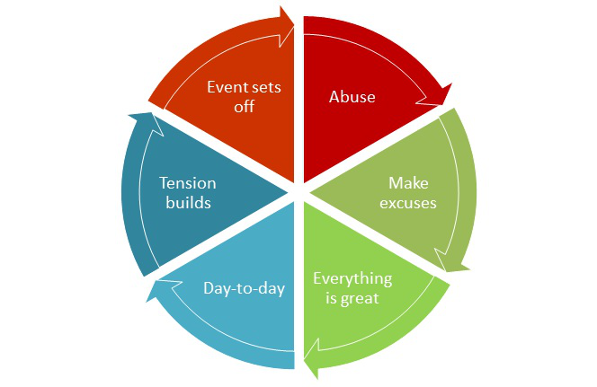

# Chapter 10: Types of Abuse, Cycles, Safety, Legal

### Purpose

Chapter 10 helps you know how to identify abuse, categorize behaviors into types of abuse, recognize the cycle of abuse in your life and seek appropriate help if necessary.

### Where does it occur?

Domestic violence has many forms, including physical violence, sexual domination, emotional trauma, social isolation or economic restrictions. 33

Domestic violence occurs in all cultures, ethnicities, races, religions, and in all socioeconomic levels.

Victims of domestic violence can be both men and women, and can occur in same-sex and opposite-sex relationships. In some cases throughout this text, there are references to abuse using masculine pronouns for writing purposes only, and does not try to limit or suggest that only males can be abusers. Abusers can be anyone regardless of gender, sexual orientation, age, physical size, body strength. They are often in a relationship with the victim and can be family, friend, neighbor, coworker or other close tie.

### Definition: Domestic abuse

Domestic violence is defined as, “abusive behavior – emotional, psychological, physical, or sexual – that one person in an intimate relationship uses in order to control the other.” 34

### Abuse escalates 

> *“Years of emotional and verbal abuse finally escalated to physical abuse, and I had to go to the emergency room for treatment.”*

### Physical abuse

Physical violence can be both Direct and Indirect:

Physical abuse — Direct

• Hits, slaps, punches or kicks.\
• Shoves or chokes.\
• Restrains you or keeps you from leaving.\
• Rapes you or sexually controls you.\
• Locks you out of the house or car.\
• Abandons you in a dangerous place.\
• Refuses to help you when you are sick, injured or pregnant.\
• Subjects you to reckless behavior while driving or at home.\
• Threatens to hurt you with a weapon.

Physical abuse — Indirect

• Abuses your pets.\
• Throws objects at you.\
• Breaks furniture, belongings, personal effects.\
• Forces you to break the law; shoplift, sell drugs or sell your body.\
• Makes you submissive by threatening to go to the authorities or immigration.\
• Withholds important personal papers, passport or immigration documents.\
• Withholds medicine you require.35

### Just to cope 

> *“To cope with the abuse I was experiencing, often my soul would separate from my body. So that I could remove myself from the “machine gun spray” of words. My skin transformed into an empty shell and my inner soul would dissociate to escape from the abuse.”*

Unfortunately, instead of removing myself from this situation, by creating a survival technique, I became emotionally numb which perpetuated the abuse. Later, I learned this was how I survived the abuse so I could be free from the blame.

### Emotional abuse

This form of abuse is very common and can be one of the worst forms. When there is no physical violence, many victims do not recognize what they endure as abuse. They, and others, make excuses to justify the verbal lashings.

Emotional abuse erodes self-esteem and can do long-lasting damage to the mental, emotional and physical state of the individual. It can act as a silent destroyer because it is able to be sustained for long periods of time.

Over time you are emotionally worn down by your abuser. The way you are treated becomes your new “normal” and your objectivity diminishes and you lose sight of how destructive this pattern is in your life.

The abuser uses tactics of blame, criticism, intimidation and verbal harassment to destroy your sense of safety, self-esteem, and self-worth. Often the abuser lies and manipulates the truth, so you become confused and have nowhere to turn. This form of abuse destroys your sense of individuality and personal value and increases the power of the abuse.36 Then you become afraid, alone, embarrassed, helpless and guilty.

Some victims have described that they have felt their life force was being “sucked up” or “drained away” by their abuser.

Emotional abuse can be Verbal or Non-verbal: 37

Verbal —

• Criticizes you alone or in public.\
• Shouts at you.\
• Humiliates you or pokes fun at you.\
• Insults your beliefs, religion, race, heritage or social class.\
• Speech, jokes, and stories are demeaning to women as a group.\
• Threatens to leave you or says you will be leaving.\
• Punishes children when you don’t comply.\
• Threatens to kidnap children if you leave.\
• Tells lies to manipulate you.\
• Says you are the one that is crazy.\
• Subjects you to violent mood swings, keeps you on an emotional roller coaster.\
• Constantly criticizing what you do and how you do it.\
• Calls you “stupid,” “incapable,” “inadequate”.\
• Tells others and your children what a bad parent you are.\
• Insults, put downs, or criticizes you in public.\
• Complains about your physical appearance making you feel inadequate.\
• Threatens to take you to court.\
• Blames others.

Non-verbal —

• Using “the look” to scare you or to bring you into submission.\
• Grits teeth or grimaces at you.\
• Shake fists or fingers at you.\
• Stands close or in an overbearing way.\
• Blocks access to door or means of escape.\
• Ignores you.\
• Punishes by withholding approval, appreciation or affection.\
• Withholds praise or good feelings from you.

### Brainwashed 

> *“Emotional abuse can be compared with intentional brainwashing. Emotional abusers usually leave the victim confused, weak, depressed, angry, and numb with unclear thinking — and yet loyal to their abusers, hoping the abusive behavior will change…Emotional abuse can produce scars that will remain with you for years.” 38”*

### Sexual abuse

Signs of Sexual abuse: 39

• Harasses you about having an affair.\
• Stalks you during your daily activities.\
• Disrespects women in general, or other family members.\
• Demands you dress in a way that you are not comfortable with.\
• Does not care about your feelings toward sex.\
• Criticizes you sexually either alone or in public.\
• Forces you to perform sexual acts you are not comfortable performing.\
• Withholds sex and affection.\
• Calls you sexual names like “whore” or “frigid” in private or public.\
• Forces you to undress when you do not want to undress.\
• Shows sexual interest in other women.\
• Has affairs after agreeing to a monogamous relationship.\
• Forces sex when you are sick or it is a danger to your health.\
• Forces sex for the purpose of hurting you with objects or weapons\
• Commits sadistic sexual acts.\
• Rapes you or coerces you sexually.\
• Requires you to watch or engage in pornography when you are not interested.

### Social abuse

Signs of Social abuse: 40

• Restricts your ability to work or volunteer for social interaction.\
• Limits contact with your family or friends.\
• Harasses or punishes you for having friends, makes fun of them, interrogates you and often makes it so difficult that you end the relationship.\
• Physically moves you away from a familiar location or area where you have an established social network.\
• Friends of abuser are chemically dependent.\
• You feel like a prisoner.\
• Not allowed to schedule your own time.\
• Won’t let you socialize with others and/or won’t take you out.\
• Does not allow you to take the car alone.

### Financial abuse

Financial abuse signs: 41

• Provides 100% or the majority of the income for the household and uses that fact to control, intimidate or manipulate.\
• Restricts you from working.\
• Refuses to work leaving finances strained and unbearable.\
• Keeps the family in debt.\
• Causes trouble for you at work which can lead to embarrassment or disciplinary action by your employer or even termination.\
• Forces you to work at a job you dislike.\
• Allows no access to money or resources.\
• Assets are controlled by abuser.\
• As a punishment or to force you to comply to their request, they take control or withdraw all family money leaving you struggling.\
• No independent access to money.\
• You are kept pregnant and not allowed access to birth control when you have requested it.\
• Abuser threatens you with divorce or that he will not let you get a divorce.

### Still with your abuser

If you are still with your abuser:

1. If you are in immediate danger or your life is at risk call 9-1-1.

2. The outcomes are often unknown while living with an abuser. Seek help and do not do this alone. Your safety is very important.

3. You can call a crisis line in your local area that will give you resources in your community.

4. Contact family centers, battered women shelters, crisis centers in your area.

5. You can call your local police or sheriff’s office and ask them to direct you to someone who can help you about domestic abuse.

6. If you have safe access to the internet search for domestic abuse + your city or county, and you will find many resources that are in your area and a wealth of reading material to help educate you. Local libraries have free internet access.

7. If you have been involved with the court system, the State Attorney’s office has a Victim’s Advocate and counseling programs that are available free of charge to guide you through this educational and your recovery phase.

Even if you are physically separated from the abuser, you may still feel they are trying to control and abuse you:

1. Recognizing the behavior you endured as abusive is important. Their incorrect behavior allows you to be free from guilt. You did not cause it. You cannot do anything better to make it improve.

2. Start connecting with people: Stronger than Espresso®, church activities or individuals with similar interests.

### Identify commonalities

Coming to terms with the abuse can be shocking, debilitating, and even sickening. This is the beginning of your long journey.

From the previous lists of types of abuse, answer the following questions:

• After reviewing the various types of abuse, which ones stand out the most?\
• Which ones have reoccurred in multiple relationships you have had?\
• List any abuses that you remember observing from your home growing up?\
• In your next relationship how will you establish boundaries so these do not occur?

### Who has control

Control impacts my relationships:\
• Who has control over you in your life?\
• Describe how this person(s) make you feel?\
• What would be the risk if you asked them to stop treating you a certain way?

### God’s intention 

Healthy relationships are designed differently. Unfortunately, many of us who experience abuse as adults experienced abuse as a child. Healthy and normal were not words we would have used to describe our family relationships growing up.

Healthy relationships are full of love, respect, kindness and a mutual agreement that each person is an individual. Each individual has the right to have boundaries, the right to say Yes or No, and the ability to live in an environment free from this type of abuse.

What love is it supposed to be:

> *“Love is long suffering and kind. Love is not jealous, it does not brag, does not get puffed up, does not behave indecently, does not look for its own interests, does not become provoked. It does not keep account of injury. It does not rejoice over unrighteousness, but rejoices with the truth. It bears all things, believes all things, hopes all things, endures all things. Love never fails…”*  
**— 1 Corinthians 13:4–8 (NLT)**

• Describe people, places or events that have made you feel you received this kind of love?\
• To whom can you show this kind of love?\
• What is holding you back from loving yourself like this?

### Healthy Relationship Comparison

Review the comparison of healthy to unhealthy relationships:42

|  | Area |  | Type of Abuse |  | Unhealthy Relationship |  | Healthy Relationships |
|------|------|------|---------------|------|------------------------|------|-----------------------|
| Children |  | Emotional |  | Use children to promote guilt, threaten, transfer adult information, elicit fear of their safety. |  | Responsible parenting. Does not use children for abuse or manipulation. Shares parental responsibilities. Positive role model for children. |  |
| Criticism, Put Downs, Talking Incessantly |  | Emotional |  | Repeated negative criticism, unrealistic expectations cannot be met, always under achieving, disrespectful, no quiet time given for you to rest or think. |  | Honor and respect you in private, and in front of others. Does not make fun of you. Agree on expectations and set mutual goals and understanding. Respects your need for quiet time. |  |
| Financial |  | Economic and Emotional |  | Prevents you from getting or keeping a job, controls finances, takes your money. |  | Economic partnership. Money decisions are shared. |  |
| Interrogation |  | Emotional |  | Excessive questioning based on abuser’s fears. Being pulled through the “interrogation funnel.” When they begin they will not let up; keep badgering. |  | Honesty. Questions are based out of interest, no need to manipulate, control or trap. |  |
| Isolation |  | Emotional |  | Attempts to control what you see, when you go out, who you see, who you talk to, what you read and where you go. Based by jealousy, criticism and fear. |  | Supports your goals, respects your right to your own activities, feelings, friends and opinions. Mutual trust and support. |  |
| Mental Games |  | Emotional |  | Confusing behavior. Kindness followed by cruelty. Lying and manipulation. Continuous state of chaos. Says that “you are crazy.” Blames you for their actions or for all the problems in relationship. |  | Consistent behavior and expectations. Honest communication. |  |

|  | Areas |  | Type of Abuse |  | Unhealthy Relationship |  | Healthy Relationship |
|------|-------|------|---------------|------|------------------------|------|----------------------|
| Physical Threats |  | Physical |  | Uses fists, body language, gestures or weapons to encourage or force submissive behavior. |  | Negotiate mutually agreed compromises. No threats necessary. |  |
| Power and Control |  | Emotional |  | Treats you like a servant. Does not allow you the ability to make choices. |  | Shared responsibility. Work together to distribute work. One party is not more powerful than the other. |  |
| Pushing or Shoving |  | Physical |  | Pushes or shoves out of frustration, anger or power. |  | No one has the right to push or shove another person. |  |
| Responsibility |  | Emotional |  | Shifts responsibility to abused. Accuses, blames others, and twists truth. |  | Accepts responsibility for own actions by being truthful when wrong. |  |
| Sexual |  | Sexual |  | Rape, force inappropriate or unwanted sexual acts. |  | No one has the right to force sexual activity on any other person. |  |
| Time |  | Emotional |  | Obsessed: Jealousy or stalking. Preoccupied with your thoughts and whereabouts. Neglect: Ignores you. Does not have time or interest in you. |  | Healthy interest in you and your activities. Allows you space and freedom to balance individual and relationship demands. Eager to spend time-sharing your thoughts and interests. |  |
| Verbal Threats |  | Emotional |  | Make threats to: Hurt you or your family. Leave you. Cut off money. Divorce you or refuse to divorce. Discredit you. Take you back to court. |  | Negotiation, fairness and safety. Compromise with no threats. Reach resolutions to conflict that are good for both parties. |  |

### Table 2. Healthy Relationship Comparison.

### Reprogram

You can’t change them. The individual must decide to change.

Work on yourself and pray for God to change your life.

You can also pray for the abuser as a part of your act of forgiveness. You may need time to be emotionally and spiritually ready for this step — don’t rush it.

If the abuser sincerely requests for God’s grace to move in their life they too can find freedom from their need to control others in unhealthy ways. This, however, is between them and God.

You are not responsible for their recovery.

• Identify warning signs you have experienced in past or current relationship.\
• Compare those to the healthy/unhealthy behaviors chart. Describe how your relationship would be different if you expected only healthy behaviors.\
• Imagine if God planned your relationships and your healthy partner. What standards and guidelines would He establish?

Making the shift to loving and healthy relationships can be hard when you are still in an unhealthy pattern, struggle with love addiction or just can’t stick to your “No.” You may know the signs and red flags, but not willing to accept them in someone you care about. Often justification of another’s behavior can occur in this lesson. You should not have to justify behavior. Self-check by seeking wisdom. Ask your Stronger than Espresso Sisters about the signs you see in this other person and ask their objective point of view.

### Cycles of abuse

In abusive relationships, you repeat an abuse cycle. This process becomes the new blueprint of how you act, react and interact in your relationships. The longer this cycle continues you become more engrained into this perpetuating the cycle. If you are unable to recognize this pattern when it occurs, you lose perspective and become unaware of the repetitiveness.

### What is the Cycle of Violence?

Lenore Walker, a legend in the field of domestic violence, constructed the model of the Cycle of Violence which consists of three basic phases: 43

### Phase 1

Tension Building Phase — Characterized by poor communication, tension and fear of the next outburst. Minor battery incidents. Increased tension and anger. Blame and prone to argue. Victim denies own anger at being unjustifiably hurt. Time length variable.

### Phase 2

Acting Out Phase — Characterized by outburst of violent abusive incidents. Battering, including hitting, slapping, kicking, choking, use of objects or weapons. Verbal threats and abuse, including sexual abuse. Time length 2– 24 hours, maybe longer.

### Phase 3

Honeymoon Phase — Characterized by affection, apology and apparent end of violence. Period of calm. Victim believes abuser can change. Time period is unknown but tends to decrease over time.

### Let’s break down the cycle even more:

### Figure 8. Abusive Relationship Cycle.

### How the process continues:

44

### The paradox exists, because the abuser does not want to face the fact that his problems are within himself.

Abuser Victim

### This denial allows the abuser to blame someone else for his emotions, feelings and actions.

Accepting the blame becomes the specific purpose of the victim.

### The abuser has an emotional attachment to the victim that is not love.

The victim will accept blame to survive, and will operate from the theory that if they can make the abuse happen, they can also make it stop. That is not true.

### They have an unhealthy dependency to reinforce blame and avoid accepting responsibility for his actions.

The victim does not create the abuse and does not have the power to make it stop.

### Only way to make it stop: responsibility for his actions.

When you have been a victim of this type of relationship for a long period of time or had numerous relationships with these characteristics, you are not experiencing true love from another person. Abuser accepts

### Table 3. How the Abuse Process Continues.

Only way to make it stop: Victim must stop accepting blame. Source: Stronger than Espresso, Inc. © 2014.

### Your new standard

The whirlwind romance followed by a roller-coaster relationship is not healthy. Set new standards for healthy relationships. Accept nothing less.

### Oh no, not again! 

> *“Once away from the emotional and physical abuse, I sought support and tried to trust new people. Being raw, weak, and vulnerable, I played right into the hands of another person who was a new type of abuser. This person gained my trust, and then stole financially from me during the time I was trying to rebuild.”*

During those few years it all seemed to make sense why I was giving all my money away to this individual, but it left me financially captive in another bad situation. I found it almost impossible to believe that this individual could be hurting me when I thought I finally built a bond that was safe. It took physically moving away from this person to release me from this situation, and a long time before I could admit that I was used; again!”

### Warning signs

Batterers have common behaviors that are warning signs you should know. If you are currently dating or meet someone with these red flag behaviors, know there is a strong potential for violence. The more signs the person has, the more likely they are to be a batterer.

Remember that abuse escalates. What might be limited to emotional and/or verbal abuse can easily escalate.

Think about a small child’s behavior when they get angry. He/she may throw a toy across the room when they get frustrated. When an adult maintains these childish behaviors and does not “get their way,” this can mean violence directed towards you when they are frustrated.

### What to look for

Be aware of abuser characteristics and know what people to avoid: 45

• Blames you or others for his bad mood.\
• Blames you or others for inappropriate behavior.\
• Breaks or strikes objects.\
• Constantly manipulates you, other people or situations.\
• Controls whom you speak to, when you go places, where you go, what you do and how you get there.\
• Cuts you off from friends, coworkers, family and neighbors.\
• During an argument they hold, restrain, push or shove.\
• Easy to anger or easy to be hurt by others.\
• Terrorizes others into submission when angry.\
• History of battery exists.\
• Isolates you from resources: money, food, social interaction.\
• Is jealous or stalks, calls constantly, visits unexpectedly, checks mileage.\
• Masterful at fooling others of the truth; may even brag on how easy it was to manipulate, lie or cheat someone else.\
• Needs to know your whereabouts.\
• No concern for your desire for sex; holds you down, forces you to perform acts you are not comfortable with. Manipulates you so you will comply; makes fun or criticizes you sexually.\
• Polite and charming to others. Different behavior at home that no one sees.\
• Pressures you to commit to the relationship right away, even if you are not ready.\
• Questions excessively; interrogation.\
• Sudden changes in mood from ecstatic to explosive.\
• Thinks people are out to get him or are plotting against him.\
• Threatens you or your loved ones in any manner.\
• Whirlwind romance; requires quick commitment.\
• Will not accept responsibility for mistakes made.\
• Criticizes you because you are unable to meet all their needs or be the perfect mate.\
• You do not feel safe leaving them alone with your child or pet.\
• You do not feel safe with them when they are angry.\
• You feel they are cruel to your pet or your child.\
• Your sense of safety has eroded or disappeared.\
• Excessive texting, found spyware on your computer, demands your online passwords.\
• Is cruel, demeans or frightens you when you are sick, vulnerable or pregnant.

Describe characteristics that sound familiar.

### Abusers desire control

The abuser has an intense desire to control. The victim helps the abuser continue to feel that his/her problems are not within himself/herself. When the victim is not available, the abuser often gets upset and experiences guilt and depression. The abuser is most likely to become most violent if the victim threatens or attempts to leave.

### Safety Plan

If you are considering making a change to a relationship, or have made a recent change in the past, you should have a safety plan. No matter how long you have been out of the relationship there is always a need for safety. All women should have emergency contact and resource numbers.

### Safety plan

Once you have identified that you are in an abusive relationship and assessed your danger, you must take caution and build your safety plan.

Prior to your “aha moment,” you would play your part in the cycle of violence perfectly and your abuser could count on it. Once you start to realize that this behavior is not okay, it is human nature to want to stop it. Be careful that you do not try a method that is not safe and smart.

Be patient and think about what you are doing before you do anything. Your danger level at this time is extremely high. Remember: educate before you activate.

### I am out of danger

No matter how long you have been away from the relationship, protecting your safety should always be a priority. Time often does not change their need to control those around them. You may not be aware of their need to bring you back into their circle of control. Even creating a modified version of a full safety plan will keep you and your family safe for years to come.

You may have a friend, family member, neighbor or coworker that is an abusive relationship. Be prepared to give them the advice, help and support they need too.

### Generate your safety plan

It is now time to construct your safety plan.

List important phone numbers and addresses and keep it in a safe place. Include emergency numbers, local police or sheriff, shelter crisis lines, family members, friends, work associates, legal advocate, children’s day care, baby sitter, school and doctor offices. 47 Below is a chart to use as a guideline:

### Emergency

9-1-1 National Domestic Violence Hotline

| Emergency | 9-1-1 | National Domestic Violence Hotline | 800-799-SAFE 800-799-7233 |
|-----------|-------|------------------------------------|---------------------------|
| Police / Fire | ( ) | Local crisis line or shelter number | ( ) ( ) ( ) |
| Work | ( ) | Family | ( ) |
| Supervisor’s cell | ( ) | Family | ( ) |
| Physician | ( ) | Family | ( ) |
| Pediatrician | ( ) | Friend | ( ) |
| Child School | ( ) | Friend | ( ) |
| Baby Sitter | ( ) | Friend | ( ) |
| Workmate | ( ) | Workmate | ( ) |
| Neighbor | ( ) | Neighbor | ( ) |

### Steps to take

• Plan the escape route from home and practice it. Know that you have a safe place for you and your children in an emergency.\
• Teach children how to use an emergency phone. Keep prepaid phone card in a safe place. Go to a women’s shelter and ask for a free cell phone to call 9-1-1 if necessary.\
• Ask trusted neighbors, family and friends to listen, watch and call for help if they see suspicious activities around or near your home.\
• Create a code word to with friends and family when you need help.\
• When violence erupts, avoid the kitchen, bathroom and any room without a door to the outside.\
• Make sure all locks and lights work inside and out.\
• Ask yourself, is there anyone you can trust. Select a person you trust outside you and your partner’s circle of friends. Share with them your need to have a safety plan.\
• Find a safe place to keep an emergency kit outside of home and car. Keep it either at your work or with a trusted friend.\
• Recommended items to keep in your Emergency Kit:

| • ID / Passport | • Birth certificate | • ATM card/ checks |
|-----------------|---------------------|--------------------|
| • Social security card | • Food stamps, Medicaid card | • Health care ID |
| • Extra house key | • Extra car key | • Medical records |
| • School records | • Copies of joint bills / loans | • Proof of partner’s income |
| • Copies of legal papers / Injunctions | • Car registration | • Prepaid long distance card |
| • Change of clothes | • Prescriptions | • Personal hygiene (toothpaste, toothbrush, shampoo, lotion) |
| • Keepsakes, photographs | • Formula / diapers | • Recent photograph and personal information of abuser, auto, work phone, addresses etc. |
| • Bottled water and non-perishable foods items | • cell phone | • Cash |

### Safety plan at work

Domestic violence does not always remain in the home and can present situations at work that are not only embarrassing, but can be dangerous. Working requires routine, specific drive times, and an established driving route. Be alert and aware that if the abuser wants to find you, they can. Typically they may contact you during the workday or on your way to and from work. If you can, attempt to follow the suggestions below. Disruptions at work could cause you to put your job at risk.

Review the following tips: 48

• Notify boss or coworker of the situation and give them instructions on what to do if you do not show up for work.\
• Make sure your boss is aware that if you do not show up on time that they should contact you to check if there is a problem. Make certain you make a point to be at work on time every day, or if you will be late make sure to communicate so they do not worry or overreact.\
• Ask someone to watch out for you when you enter and exit the building.\
• If needed, keep your emergency kit in your desk at work.\
• Keep a copy of the injunction at work. Keep a photograph of the abuser in case something happens.\
• Request use of the Employee Assistance Program (EAP). If your employer has this benefit, it typically offers six visits of free counseling.\
• Plan an escape route from the building.\
• Carry a whistle and have a signal.\
• Vary your route to and from work and change where you park each day.

### Safety while on your own

Once you are separated from the abuser you still need to maintain your safety. Review the list below and incorporate into your safety plan:

• Continue to have a Safety Plan at home and work as you did before. Review them now and update paperwork and phone numbers if items changed since you moved.\
• Visit a local women’s shelter and request an emergency cellular telephone if available.\
• Make sure all locks and lights work.\
• If you can, install simple alarms on windows and doors.\
• Secure windows and sliding glass doors with wood or pole.\
• Install smoke detector and get fire extinguisher. Contact your local fire department and ask if they have a free installation program. Often you can buy the detector and extinguisher at a discount through the fire department and they will install and test for free.\
• Get an unlisted telephone number.\
• Receive mail at a PO Box and do not file a forward or change of address with the post office. This information is not private and easy to access where you moved. Instead change your address with each vendor individually.\
• Get an Injunction for Protection.\
• If you put utilities in your name your address is now easy to access. Any attorney, private eye or small fee internet investigative company can pull that information on you. If you can, and if necessary, put utilities in a friend’s name.\
• Are you being tracked with a GPS tracking device? Does your vehicle have a GPS tracking device? There are many GPS tracking devices and they come in many forms. If you or your kids have been given any presents they may contain a tracking device?

Accounts can be activated or GPS initiated by the abuser for tracking if their name is on the account or car title.

• Are you being watched? Hidden cameras come in many different forms? They may be installed in your home and you unaware\
• Do they seem to know everything you say? Cell phones can be put in auto answer, silent mode and act like a simple “bug.” They can be hidden in your home or car without your knowledge.\
• Immediately, put a verbal password on cellular phone, banking, and credit card accounts.\
• Contact your cellular phone, banking and credit card companies and confirm all your contact information, specifically your email address. If you do not have email make sure that you have a verbal password on these accounts so that none can be added without your knowledge. It is very easy for someone to call, pretend to be you, request to add or update your email address, activate or reset online account services. Online they request a new password be sent to the new email they noted on your account. Once logged into your account, they can print statements, view current activity, track you, or harass people you are talking to. They can remove the email just as easily and you may never know that it was done. Make sure to protect all accounts with a verbal password so updates like that cannot be done without your knowledge.\
• Remember this individual typically has all your personal information, social security, family history, address history, and password histories. Change your security questions or mother’s maiden name to a word that only you know so you are protected. Change all passwords to a word or letter combination you have never used before.\
• Remember that when you sign a lease on an apartment a credit check is conducted which will show on your credit report. If they pull a simple background check report from the internet they can find it.\
• When you change your address with your credit card companies, this information and your new address will be boldly listed on your credit report. If you were married or had joint credit, your new address may be displayed on his report too.\
• You can have your mail sent to domestic violence center and forwarded to you if you must. Make sure to be in contact with your local crisis center to discuss how they can help you. Keep a log and record any communication from the abuser.\
• Do not communicate or retaliate with the abuser. This can be very difficult as they will try any means to get you to call them back, meet them, help them or see them.

Remember, they are a master manipulator who receives power by actions and words directed at you. You do not have to talk to them. Sometimes it seems easier to just get it over with when you are being harassed, but communication just perpetuates the game in their mind. They do not want to be ignored and they do not want to face their problems without you to blame.

• In extreme cases you can change your social security number, but requires assistance with your local crisis center. When you do this your credit history is deleted and your accumulation of your payments into Social Security (your ten quarters) is voided, which would cancel your benefits available at retirement. Recognize that they can “find you” with many other means than your social security number so think very carefully before pursuing this option.\
• Make an appointment with your medical doctor and tell them what is going on. This documents your situation. The medical doctor may give you a prescription to visit a counselor and it may be covered by insurance. They also can prescribe medication for this transition time making it easier for you to cope with the stress. You will be full of fear, anxiety and may not be sleeping or thinking clearly. It is important to listen to their medical advice.\
• Do not resort to alcohol, sex with strangers, drugs or any other behavior during this time no matter how much you can justify it. Keep your wits about you. This is vital to your success in this transition. Learn how to live with yourself. Yes — you will make yourself crazy, but it is only for now. Abstain. Practice self-respect. Love yourself just as you are.

### Make your safety plan

Describe the safety plans you need to make?

Make a list of the items you need to complete this week to ensure your safety:

### God is with you in trouble 

Reading Bible verses can be very valuable when you are feeling in trouble, insecure or afraid. You can locate resources in the Bible to help comfort you when you going through a difficult time.

Read the verses below and describe what the Bible speaks to your heart through the holy spirit.

| Psalms Book | What does this verse speak to you? |
|-------------|------------------------------------|
| Psalms 27 |  |
| Psalms 28 |  |
| Psalms 37 |  |
| Psalms 102 |  |

Describe how God is with you in trouble?

### What about them?

If you are asking the question, “Can they change?” you are evaluating the relationship at some level. If the person you are with is abusive they will need to dedicate to the work required to change. Working with a professional counselor, enrolling in programs like an anger management programs and counseling specifically designed for abusers individuals is a must for the abusive patterns to have a chance to stop.

### Can the abuser change?

Can the abuser change? Yes, but only if they seek help, admit their problem and commit to a lifelong change of their behavior. Anything less, they will fail and fall back into old habits. For change to be successful, the abuser must prove all the following criteria:

• Admission — Abusers must admit their problem. Identifying the problem is the first step to correcting it. Without this step, there will be no change. Blaming you or something else is not admission.\
• Ask for Help — The abuser must request professional assistance. The counseling must be individual at first, and then later can include marital or group counseling. Violence as a solution to a problem is not acceptable. There is no need for marital counseling until the abuser can respond to his feelings and emotions in a non-violent way.\
• Commitment — Abusers must commit to working on their problem. Without a firm commitment to resolve the problem, they will fall away when the going gets tough. You already know life is tough, and this will test them.\
• Motivation — Abusers must be motivated only by their desire to change and improve. One key characteristic of an abuser is that they blame others for their problems. If they are not the sole source of motivation, they will again have a vehicle to continue to blame others as to why they could not complete or change at this time.\
• With God all things are possible. They must attend counseling, approved court programs, 12-Step program, or other support group to help the abuser change. It takes hard work to change; much more than “lip service.”\
• Test of time — Abusers must be observed over a long time period to ensure that new behavior patterns have been integrated successfully. The cycle of abuse is clear. There is a honeymoon period where abusers say they are sorry and may try to get counseling and change. Then the daily routines begin and time passes. At some point, tension builds and it is at this point when the abuser and victim must work through this stage with entirely new scripts. This is not an easy task on a good day!

If the victim accepts them back too soon, they will experience the cycle all over again. Time is the only way to know if that stage can be stopped and corrected.

• Addictions Must Stop — Abusers must stop using any substances that escalate their violence or anger. Alcohol, drugs, gambling, pornography, food or any other vice can easily become a crutch and an excuse for inappropriate behavior. Test their commitment level. If they “can’t leave the booze,” they will not commit to run the course no matter what they are telling you. Substance use, stress or anger is never an excuse to justify violence or dismiss abuse.\
• The abuser must be ready to undergo emotional, physiological and spiritual “surgery.” They have to be committed to do whatever it takes to be transformed at every level. If they are not ready to commit to the surgical knife, then they will not change and you should not expect any other outcome. Time to move on!

You may wish to return to the beginning of this Chapter and review the warning signs again. If you feel that you are still afraid or you see behaviors that fit any category, you must take precautions. Do not return to this individual or this situation if you suspect abuse is likely!

### God’s forgiveness

God forgives those that have hurt us. He models the behavior he expects us to perform.

### Overview

This is just a basic overview of the legal basics. If you have someone who is in need of legal help, refer them to legal counsel. Locate resources in your area and have those ready to provide for women in your group.

### Police warning 

> *“Our case was dismissed when the defense lawyer found a loophole in the charges and we left the courtroom. The female police officer pulled me aside and told me that she spent time around my husband during these proceedings and said, ‘He is crazy. I’ve seen too many things like this and I don’t want you to end up dead somewhere. Buy a gun and learn how to use it. He just isn’t right.”*

### Legal

The legal services will vary by area. The State Attorney’s Office will have information pertaining to programs for abuser education. Traditionally, these programs are required as part of probation for defendants of domestic abuse cases. As with any course, you get what you want out of it.

If the abuser is ready to change and makes the commitment to do so, these courses will be a refreshing source of information, not just a legal requirement that is a “waste of time.” If you are in communication with the abuser, listen to their attitude and description of these courses or programs, which will tell you everything about their desire to change. The programs in your area may be in development; these are similar programs in the USA.

• Domestic Abuse Intervention Program (D.A.I.P.) – This treatment program is for abusers arrested for domestic violence and includes participation in a Domestic Safety Program. 50\
• Domestic Safety Program (D.S.P.) —A six month group counseling and education program for men who batter designed to aide them understand the belief system that supports that behavior.51\
• Batterer’s Intervention and Prevention Program (BIPP)—This program is much more than anger management. BIPP addresses socio-cultural issues, particularly regarding gender and violence, teaches and develops critical thinking skills, and includes therapeutic topic elements such as empathy, accountability, and communication. Often court ordered.

| is much more than anger management. BIPP | addresses socio-cultural |
|------------------------------------------|--------------------------|
| issues, particularly regarding gender and violence, teaches and |  |
| develops critical thinking skills, and includes therapeutic topic |  |
| elements such as empathy, accountability, and communication. Often |  |
| court ordered. |  |

### Legal rights

Basic information about legal rights. This information may vary in your area:

• Contact a local shelter or the National Domestic Violence Hotline at 1-800-799-7233 for the most current details, legal updates, available programs, and to find help you need.\
• Battery is a crime, regardless of who commits it.\
• If you have been assaulted, physically or sexually, by your partner, you are the victim of a crime. You have the right to request an Injunction of Domestic Violence. You may request a Final Protective Order or a Magistrate’s Order for Emergency Protection (MOEP). The MOEP is an emergency protective order after an arrest to protect the victim from further abuse or harassment from the abuser.\
• If the police are involved and they have probable cause that a battery has occurred, evidence of harm or a witness, they will make an arrest.\
• All complaint and arrest affidavits will be reviewed by your legal division.\
• Your legal division may have a Victim Witness Assistance Program. This program is designed to help you understand your rights as a victim and can gain access to literature, counseling and other services to assist you during this time whether or not there has been an arrest. They will also support you during the prosecution of your domestic violence case.\
• You may contact your local Domestic Violence program direct to access literature, free 9-1-1 cell phones and counseling services or contact the National Domestic Violence Hotline at (800) 799-SAFE.

### Family Crisis Centers

Typically in each city, county or district there are government-sponsored programs that are designed to assist victims of domestic violence. Often they have a wide range of services including:

• Basic needs: emergency housing, food, child care, temporary housing, assistance\
• Civil legal representation for family, immigration, housing\
• Classes/Education: Understanding Abuse, Anger Management, Moving Beyond\
• Counseling services\
• Crisis intervention\
• Employment assistance\
• Information and referral\
• Law enforcement\
• Medical\
• Military liaison\
• Parenting skills and support\
• Prosecution\
• Protective orders\
• Sexual assault counseling\
• Spiritual access\
• Substance abuse treatment

### Break the cycles

Help you know how to identify abuse, categorize behaviors into types of abuse, recognize the cycle of abuse in your life and seek appropriate help if necessary. In the next Chapter, you will focus on rebuilding your self-esteem and break free of these cycles of abuse in your life.
