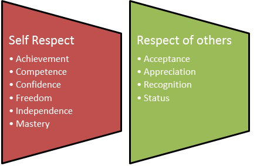

# Chapter 11: Self-esteem Defined

### Purpose

The purpose of Chapter 11 is to help you understand what self-esteem is and why it is so important for you to nurture and develop.

### I was worthy 

_“My self-esteem had to be rebuilt so that I could believe that I was worthy of creating a plan of action. The results from the rebuilding process have allowed me to believe in myself and to heal from the pain.”_

### Definition: Self-esteem

Self-esteem is the perception or emotional point of view you have of yourself. It may differ from what could be defined by reason or logic. 53

### What’s normal?

After years or a lifetime of abuse, your self-esteem has been bruised. It may

feel broken, but now there is hope. It can be restored!

Self-esteem is how you view your value to yourself and to others. It provides a unique picture of how you view yourself at a given point in time. Your self-esteem is as individual as you are and can vary slightly from day-to-day.

Self-esteem can be likened to your coffee order, some days you might want it with one shot, two shots, or a triple shot of espresso. You may prefer non-fat, low-fat or all fat, or you may want your steamed milk light or extra frothy. Your self-esteem can vary depending on your current circumstances, current emotional situation and current relationships.

Self-esteem can be measured as a snapshot where you are right now and can fluctuate. When faced with adversity or a scary situation, it is normal for a healthy self-esteem level to drop; but as the challenge is overcome, it rises.

The foundation for self-esteem begins in the formative years as a child. As you grow older, other influences direct what pathways you cement to form your self-beliefs. Each year, each experience adds more to your self-esteem picture. A person with low self-esteem who is discouraged, weak and inferior is an easy target for abusers. Chronic low self-esteem can be rebuilt.

### Historical research on self-esteem

In 1969, Dr. Nathaniel Branden defined self-esteem as, “…the experience of being competent to cope with the basic challenges of life and being worthy of happiness.”

Experts disagree over an exact definition; however, Branden’s appears to be widely accepted and has withstood the test of time. Branden broadens that definition to include the following primary properties:

1. “Self-esteem as a basic human need…indispensable to normal and healthy self-development.”

2. “Self-esteem is a consequence of the sum of the individuals’ choices.”

3. “Something experienced as a part of, or background to, all of the individual’s thoughts, feelings and actions.”

Abraham Maslow defined self-esteem to include two kinds of esteem needs, the need for self-respect and the need for respect from others. When these needs are not being met, the individual feels discouraged, inferior and weak.

### Self respect

When you possess self-respect, you have a sense of personal achievement. You believe you are competent and have confidence in your ability to perform daily duties successfully, at home or at work. Will you make mistakes? Of course, but that’s all it is. You become free from the ups and downs that pull you from euphoria to despair based on the actions of others. It takes time to master this skill, but it can be yours. God made a promise to you and to us all that he would be our strength, our shelter, our rock.

### God’s promise to you 

Our God is strong and you can have confidence in Him. Part of having a healthy self-esteem is being confident that you can weather the bad times and are still worthy of love and acceptance.

With confidence you are able to “not take it personally” when others are not kind to you or don’t act the way you want them to. It is not your fault, nor your responsibility to be in charge of their behavior.

God’s promise is that he give us confidence no matter what we face because he is here:

> _“God is our refuge and strength, An ever present help in trouble. Therefore we will not fear, Even though the earth be removed, And though the mountains be carried into the midst of the sea; Though its waters roar and be troubled, Though the mountains shake with its swelling.”_  
> **— Psalms 46:1–3 (NKJV)**

> _“Be still, and know that I am God...”_  
> **— Psalms 46:10 (NKJV)**

> _“Hear my prayer, O Lord, And let my cry come to you. Do not hide Your face from me in the day of my trouble; Incline Your ear to me; In the day that I call, answer me speedily.”_  
> **— Psalms 102:1–2 (NKJV)**

How do you demonstrate you have confidence in God?

### Respect from others

In most cases, abuse victims seek unbalanced approval from others. This need for approval is called codependent behavior. It is a coping mechanism created to survive this relationship, or it has been how you dealt with your immediate family beginning as early as a small child.

You find your value in receiving appreciation from others. You work to please others and become upset or hurt when you do not receive the responses you require. Without their response of love and appreciation, you feel unloved, bewildered and empty.

Freedom comes from knowing that you deserve the respect of others regardless of what you do. You are not responsible for the choices that other people make or the behavior they demonstrate. If they have behavior you do not condone, then it is their choice. God loves you — just as you are. Regardless of how the people closest to you act. His love has no boundaries, judgment or conditions. He is an emotionally safe place for you.

When you respect yourself first, others will respect you. If there are individuals in your life that will not respect you, then they are not a healthy person for you. Creating the distance from those individuals is difficult but it is a part of the process to create personal boundaries.

Describe ways you can expect respect from others.

### Abuser’s self-esteem

Having a healthy self-esteem is important.

Self-esteem that is high, but fragile, can be called narcissistic, and it is very common for abusers to have narcissistic traits. With this type of self-esteem, the individual is focused on themselves and display arrogance, conceit and a sense of superiority. However, the display of high self-esteem is not real; it is merely a defensive reaction to their lack of healthy self-esteem.58 The charade of strong self-esteem can have dangerous outcomes as it is displayed only to fill emptiness inside the abuser versus being soundly based. If their self-esteem is challenged, it can lead to violence.

Self-esteem is the responsibility of the individual, no one else. You are not responsible for their change.

### How do you rebuild?

Working toward achieving a healthy level of self-esteem is very important, and understanding the pitfalls you may experience can guard you from setbacks. This is the beginning of a new journey for you and the first day of the rest of your life.

### My self-esteem 

How do you know the level of your self-esteem?

There are thousands of tests, books and resources available to check the level of your self-esteem. The fact that you are reading this book shows your eagerness to embrace a new you and improve your self-esteem.

Complete the Self-Esteem Inventory to gauge where you are right now. Be honest and do not think in terms of good or bad.

Review the first column and record how you would currently respond to each situation. Then review the second column outlining what a person with healthy self-esteem person. This gives you a guideline and a goal to work toward as you fabricate and mold the new you. Don’t try to perform a tabulation of how you measure up. This is your basis to establish and identify growth opportunities.

> _“My mealtimes were forgotten because my partner was passed out drunk. Every heirloom I held dear had been smashed during previous fights. Our home consisted of four walls of terror. There was no sanctuary. There was no safe place. I never gave up hope.”_
