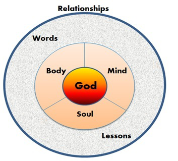

# Chapter 13: Seven Ingredients to Perfection, #1 God, #2 Body

### Jolt awake

Time to crank up the espresso machine and serve triple shot power! You are ready to Jolt Awake in life.

### Purpose

The purpose of Chapter 13 is to accept God’s amazing love and grace in your life. When you hold this power at the center of your being, you can live in freedom.

### Redefine your life

By accepting God’s amazing love and grace in your life, you hold the power to your future and to live in freedom. When you climb a tree feed with living water your experience transforms from the natural to the supernatural.

This book has focused on identifying your patterns of behavior, understanding your abusive relationships, and steps to building self-esteem.

What’s the next step?

Now you are ready to create your plan of action and get your life in motion. This Chapter helps you create your seven measures of perfection. By blending all seven ingredients you will craft a new you to last a lifetime.

### You are a survivor

Congratulations, you are ready to take the first step to define the new you as a strong survivor capable of boundless miracles.

You are a <u>**survivor**</u> of domestic violence! Do not use the word “victim” when you describe yourself anymore. That is the past; you are ready for your future.

### Focus on you

The next step in your recovery is to begin to focus on you — not the abuser. Fill your ears, mouth, and mind with your name, not the abuser’s name. Over the past months, years and for some decades, your focus has been on meeting the needs of an abusive partner. In doing so, your needs were not met or discussed. It is time to stop talking about the abuser.

You may have spent hours talking to friends, coworkers, counselors, police, and perhaps been required to testify in court. You have relived the trauma over and over again. Make a tick mark on a piece of paper each time you speak their name or when you update others about the abuser’s tactics. You will be surprised how many times per day your thoughts and words turn to them.

Sharing your story and asking for support from those around us is vital at first, but you can experience diminishing returns. Some people relish in the mire of your drama. They may unknowingly continue to “stir the pot” and find excitement in getting all the up-to-date gossip about your life. Look at our television line-up of reality shows and you can see that curiosity is a basic human trait. This behavior can perpetuate your victim persona, keeping one foot rooted in the past. Staying stuck in the past can damage your self-confidence and restrict your jump to the next step.

Reach out and connect with Christian women in the church, women Pastors, or Pastor’s wives to get the help you need.

### Your story has power to heal others

Behind every story is a survivor. You have a powerful testimony to share.

You had the worst boss in the world. You could do anything — had to do everything. You have handled intense pressure, and simultaneously protected others around you. You endured unbearable situations and still rose from the ashes. Yes you are Stronger than Espresso!

> _“And they overcame him because of the blood of the Lamb and because of the word of their testimony, and they did not love their life even when faced with death.”_  
> — Revelations 12:11 (NIV)

### Coffee is power

As you come to the most active part of the Stronger than Espresso® journey, you need to understand the keys ingredients to perfection:

| Key Ingredient                                                                             | Power that makes it possible |
| ------------------------------------------------------------------------------------------ | ---------------------------- |
| 1. Someone created the coffee plant and designed the beans to be produced for consumption. | God                          |
| 2. Physical components that are required: body, water, coffee pot.                         | Body                         |
| 3. Passion to brew a perfect cup of java.                                                  | Soul                         |
| 4. Must possess the mental know how to mix each ingredient.                                | Mind                         |
| 5. Use as a tool for conversation with others and part of a daily habits.                  | Words                        |
| 6. Experience on how to brew, what portions and how you like it to taste.                  | Lessons                      |
| 7. Who you share it with and an opportunity to meet with others.                           | Relationships                |

### Your seven key ingredients

Seven Ingredients of Perfection are what you need to restore your life. Each ingredient is required for you to restore and transform.

1. Ingredient #1, Power of God — Giving power to your God, faith as a tool for survival, setting new standards for self.

2. Ingredient #2, Power of Your Body — What to wear spiritually, healthy eating, healthy practices, managing trauma symptoms.

3. Ingredient #3, Power of Your Soul — Assertiveness, boundaries, healthy relationships.

4. Ingredient #4, Power of Your Mind — What you believe is your reality.

5. Ingredient #5, Power of Your Words — Internal and external speech.

6. Ingredient #6, Power of Your Lessons — What you have learned and what is yet to learn.

7. Ingredient #7, Power of Your Relationships — How bringing healthy people into your life can reconnect you to a lifelong change.

### Power of God Ingredient #1

The #1 Ingredient to the Seven Measures of Perfection is the Power of God. It is amazing, awesome and incredible. Faith is the belief in the existence or knowledge in someone or in something you accept as truth.

You don’t see gravity, but you have faith if you drop something it will fall to the ground. You don’t see oxygen molecules, but you have faith that they are present and they will keep you alive when you breathe. As a babe you relied on your parents to teach you what they knew, and had faith that what they taught you was true.

### Our God is strong 

Having spiritual faith gives you the support to rely on and security that you are loved. This confidence guides you through this journey to survive your situation. Through faith you can have hope that you will grow beyond this pain and be made whole again.

Looking upward instead of inward allows you to focus on a greater power.

Throughout this book we have shared numerous scriptures from the Bible that describe God’s strength for us in times of trouble.

> _“For in the time of trouble He shall hide me in His pavilion; In the secret place of His tabernacle He shall hide me; He shall set me high upon a rock.”_  
> **— Psalms 27:5 (NKJV)**

> _“The steps of a good man are ordered by the Lord, And He delights in his way. Though he fall he shall not be utterly cast down; For the Lord upholds him with His hand.”_  
> — Psalms 37:23,24 (NKJV)

> _“The Lord is my strength and my shield; My heart trusted in Him, and I am helped; Therefore my heart greatly rejoices, And with my song I will praise Him.”_  
> **— Psalms 28:7 (NKJV)**

> _“I am holding you by your right hand – I, the Lord your God. And I say to you, ‘Do not be afraid. I am here to help you…”_  
> **— Isaiah 42:13 (NLT)**

### A measure of faith 

When making a journey of healing, working on your spiritual self is a priority. Having faith plays a vital role in establishing hope and increasing the chances of human survival.

At Stronger than Espresso® we believe that Jesus Christ is our Savior and the way to eternal life. Accepting him into your heart will bring blessings into your life and the Holy Spirit will transform your life. This does not mean you will not face difficult times or hardships, but you will never again do it alone.

Regardless of your particular religion or spiritual beliefs, faith is a common theme in theology. The word “faith” or concept of faith is described in most of the major religions of the world today.

This concept, though widely debated as to its exact definition, existence and validity, weaves its description through the major religions of the world. If you were to ask anyone who has been “touched by faith,” they will most undoubtedly tell you that their lives have been blessed and they could not consider their existence without their faith.

Everyone has a measure of faith. At times in our lives we desire spiritual pathways even if we don’t know why or exactly what we are looking for. This is your measure of faith yearning to be filled with God’s great love. In order for God to lead your life, you have to accept Him in your life.

> _“For I say, through the grace given to me, to everyone who is among you, not to think of himself more highly than he ought to think, but to think soberly, as God has dealt to each one a measure of faith.”_  
> **— Romans 12:3 (NKJV)**

### Tried it all 

> _“I tried everything alcohol, drugs, exercise, journaling, angel cards, praying, daily journals, mediation, yoga, reading spiritual books by the dozen and even took a trip to China to touch the largest Buddhist statue in the world to fill this desire. I finally accepted Jesus into my heart. It was awkward at first but over the years I have been amazed by the blessings he has put into my new life, my new family, my new spiritual growth beyond my dreams. Now I can’t imagine my life without Christ at the core.”_

### God never stops loving you 

God’s love is unbelievable! He loves you just as you are. He loves you for what you have been, all that you are and all that you will be, regardless of the decisions or events you have made.

When you are able to embrace yourself and love yourself like God loves you, an amazing transformation occurs and you are energized with the power of faith!

> _“I was also blameless before Him, And I kept myself from my iniquity.”_  
> **— Psalms 18:23 (NLT)**

> _“I knew you before I formed you in your mother’s womb. Before you were born I set you apart and appointed you as my prophet to the nations.”_  
> **— Jeremiah 1:5 (NLT)**

> _“Not even a sparrow, worth only half a penny, can fall to the ground without your Father knowing it. And the very hairs on your head are all numbered. So don’t be afraid; you are more valuable to him than a whole flock of sparrows.”_  
> **— Matthew 10:29 (NLT)**

> _“Long ago, even before he made the world, God loved us and chose us in Christ to be holy and without fault in his eyes.”_  
> **— Ephesians 1:4 (NLT)**

Which scripture is your favorite? Why?

### Release your burdens 

Our burdens can feel so heavy. We carry them around unaware that God’s promise is He will carry those burdens for us. All we have to do is give them away.

When you awaken the spiritual part of you there is a transformation that occurs. When you “give it to God” you are released from the burden you carry around. By trusting in God you set aside fear. Grab hold of the hand of the Almighty and follow the pathway of joy, understanding and freedom.

> _“…How can you say the Lord does not see your troubles? He never grows faint or weary. No one can measure the depths of his understanding. He gives power to those who are tired and worn out; he offers strength to the weak. Even youths will become exhausted, and young men will give up. But those who wait on the Lord will find new strength. They will fly high on the wings like eagles. They will run and not grow weary. They will walk and not faint.”_  
> **— Isaiah 40:27–31 (NLT)**

> _“The Lord is my shepherd; I have everything I need. He lets me rest in green meadows; he leads me beside peaceful streams. He renews my strength. He guides me along right paths, bringing honor to his name. Even when I walk through the dark valley of death, I will not be afraid, for you are close beside me. Your rod and your staff protect and comfort me. You prepare a feast for me in the presence of my enemies. You welcome me as a guest, anointing my head with oil. My cup overflows with blessings. Surely your goodness and unfailing love will pursue me all the days of my life, and I will live in the house of the Lord forever.” — Psalms (NLT)”_

> _“I look up to the mountains — does my help come from there? My help comes from the Lord, who made the heavens and the earth! He will not let you stumble and fall; the one who watches over you will not sleep. Indeed, he watches over Israel never tires and never sleeps. The Lord himself watches over you! The Lord stands beside you as your protective shade. The sun will not hurt you by day, not the moon at night. The Lord keeps you from all evil and preserves your life. The Lord keeps watch over you as you come and go, both now and forever.”_  
> **— Psalms 121:1–8 (NLT)**

> _“The Lord is close to all who call on him, yes, to all who call on him sincerely.”_  
> **— Psalms 145:18 (NLT)**

> _“Then Jesus said, ‘Come to me, all of you who are weary and carry heavy burdens, and I will give you rest. Take my yoke upon you. Let me teach you, because I am humble and gentle, and you will find rest for your souls. For my yoke fits perfectly, and the burden I give you is light.”_  
> **— Matthew 11:28–30 (NLT)**

> _“Don’t put your confidence in powerful people; there is no help for you there. When their breathing stops, they return to the earth, and in a moment all their plans come to an end. But happy are those who have the God of Israel as their helper, whose hope is in the Lord their God. He is the one who made heaven and earth, the sea, and everything in them. He is the one who keeps every promise forever, who gives justice to the oppressed and food to the hungry. The Lord frees the prisoners. The Lord opens the eyes of the blind. The Lord lifts the burdens of those bent beneath their loads. The Lord loves the righteous. The Lord protects the foreigners among us. He cares for the orphans and widows, but he frustrates the plans of the wicked. The Lord will reign forever. O Jerusalem, your God is King in every generation! Praise the Lord.”_  
> **— Psalms 146:3–10 (NLT)**

### Security 

When you believe that you are a beautiful child of God, you begin a spiritual path that will heighten your self-worth.

You are loved no matter what you do.

With this security of love:\
• You form a new basis of internal strength and allow you to set new standards.\
\
• Treat yourself with self-respect.\
\
• Quiet the negative messages you have been receiving internally and externally.\
\
• Respect yourself by making appropriate decisions about your well- being.\
\
• Make better food choices.\
\
• Make better choices of moral content.\
\
• Trust your inner voice and spiritual wisdom.

> _“Can anything ever separate us from Christ’s love? Does it mean he no longer loves us if we have trouble or calamity, or are persecuted, or are hungry or cold or in danger or threatened with death? (As the Scriptures say, ‘For your sake we are killed every day we are being slaughtered like sheep.’) No, despite all these things, overwhelming victory is ours through Christ, who loved us. And I am convinced that nothing can ever separate us from his love. Neither death nor life, neither angels nor demons, neither our fears for today nor our worries about tomorrow – not even the powers of hell can separate us from God’s love. No power in the sky above or in the earth below – indeed, nothing in all creation will ever be able to separate us from the love of God that is revealed in Christ Jesus our Lord.”_  
> **— Romans 8:35–39 (NLT)**

### Glorious shifts 

Awakening your faith and spiritual self will begin a shift in your moral guidelines.

Reading **Matthew Chapters 5–8** will help give you an understanding of the basic life lesson Jesus teaches. “Treat others as you wish you to be treated” and “love your neighbor as yourself” are simple and basic. If you are to love your neighbor as yourself, but don’t love yourself how can you do this.

Proverbs also has guidelines for healthy Godly living. There are 31 books so just reading one chapter a day during the month can support your changes.

Your moral compass will naturally shift due to the influence of the Holy Spirit. You will begin respecting your body as a temple. When you do this, you begin to eat and drink appropriately to surround yourself with people which will fill holes in your heart. These “cravings” for food, alcohol and sex are replaced with God’s limitless love and no longer drive your behavior and coping mechanism.

As you spend more time with God, what shifts have you noticed in your life?

### How to pray 

Prayer is very personal and is different for everyone. There is no wrong way to pray, but sometimes people are confused as how to pray.

There may be days when all you can do is pray and ask, “Show me how I can survive today.” You may cry out to God and ask, “Why?” in anguish and pain. When you are on the brink and cry out to God, you create music to His ears.

Your life was never created to be easy. It is the challenges and lessons you sustain that make it worthwhile. You may rejoice when you feel his presence wrap you up and you begin to see light at the end of a very long, dark tunnel. In almost every circumstance, expect the valley before the joy on the mountaintop can be enjoyed.

When you are afraid, remember, that you will never be alone. God’s love does not leave you and is always there for you all you have to do is reach out and ask for it. Have faith and ask for guidance, love and support.

A few prayer tips:\
• Pray often and plan to spend time with God daily. This allows you to have more time to

> _“hear” Him through the power of the Holy Spirit.\
> • Thank God for the blessings in your life. God never wastes a hurt so your hardship could be a blessing in disguise.\
> • God will hear your prayers. “Now this is the confidence that we have in Him, that if we ask anything according to His will, He hears us.”_  
> **— 1 John 5:14 (NKJV)**

• God operates in his own time. Patience is a key to wait for answered prayer.

> _“Rest in the Lord, and wait patiently for Him; Do not fret…”_  
> **— Psalms 37:7 (NKJV)**

• Pray with other Christians:

> _“Again I say to you that if two of you agree on earth concerning anything that they ask, it will be done for them by My Father in heaven. For when two or three are gathered together in My name, I am there in the midst of them.”_  
> **— Matthew 18:19–20 (NKJV)**

> _“Pray over him, anointing him with oil in the name of the Lord…pray for one another, that you may be healed.”_  
> **— James 5:13–16 (NKJV)**

> _“Pray for us; for we are confident that we have a good conscience, in all things desiring to live honorably.”_  
> **— Hebrews 13:18 (NKJV)**

### Power of Your Body Ingredient #2

Your body is the temple to your soul. The #2 Ingredient to the Seven Ingredients of Perfection is the Power of Your Body. It is the vessel of strength that allows you to experience this wonderful life you have been given. You will create rules of respect and a treatment plan for your body. You are already beautiful just as you are. This isn’t a quick-fix program to make you okay by shedding a quick 20 pounds or making you more beautiful overnight. Rather this is about creating self-love, self-respect and a new definition of who you are. When you have been denied focusing on yourself for so many years, or thought it selfish to do so, this freedom will be foreign and uncomfortable. Being a self-respecting individual is much more desirable than a martyr. It will take time and dedication, but well worth it.

### What to wear

One of the first things we worry about when we wake up is what we are going to wear today.

Have you ever considered what God’s word says about what you should wear?

> _“Therefore, as the elect of God, holy and beloved, put on tender mercies, kindness, humility, meekness, longsuffering; bearing with one another, and forgiving one another, if anyone has a complaint against another; even as Christ forgave you, so you also must do. But above all these things put on love, which is the bond of perfection.”_  
> **— Colossians 3:12–14 (NKJV)**

> _“Stand therefore, having girded your waist with truth, having put on the breastplate of righteousness, and having shod your feet with the preparation of the gospel of peace; above all, taking the shield of faith with which you will be able to quench all the fiery darts of the wicked one. And take the helmet of salvation, and the sword of the Spirit, which is the word of God.”_  
> **— Ephesians 6:14–17 (NKJV)**

> _“It is God who arms me with strength and makes my way perfect.”_  
> **— Psalms 18:32 (NKJV)**

> _“The night is far spent, the day is at hand. Therefore, let us cast off works of darkness, and let us put on the armor of light…14 put on the Lord Jesus Christ….”_  
> **— Romans 13:12, 14 (NKJV)**

> _“She is clothed with strength and dignity, and she laughs without fear of the future.”_  
> **— Proverbs 31:25 (NKJV)**

### 5 senses

One easy way to begin to change your body is to start by indulging your five senses:

What are the five senses?

### Sight

Begin to change what you see around you:\
• Place a few items of importance around your home that makes you feel good. This can be: throw pillows, knick knacks, plants, family photographs, awards or affirmations by the light switch in each room. Think about what makes you feel happy and secure, and add that to your home.\
\
• Find a piece or two of clothing that makes you feel good about yourself and add to your wardrobe. If you are on a budget, thrift stores can be an excellent and economical source, or a women’s shelter may have a “dress for success” outreach program.\
\
• Seek out a spiritual place for you. Be still in the moment when you are there. Look around you, feel how your body calms.\

• Stare at something you enjoy: the neighbor’s flower garden, the rain pattering on the window, clouds floating through the sky, a kite at the park, or your dog sleeping.\
\
• Go for a walk in your neighborhood and spend time seeing all of the interesting creations that surround you. The roly-poly bug on the ground, the clutter of junk on your neighbor’s porch, the twisted vine branch that looks like it will come to life if you stare at it long enough. Begin to be aware of your environment and surroundings.\
\
• Go to a new place. If you always go to a local tavern, change to a local library or the botanic gardens and wander through the flower park.

### Sounds

Select sounds around you that are uplifting and refreshing:\
\
• Listen to music you like.\

• Sing out loud and praise your voice even if it’s off key.\
\
• Turn off the television. Try to read or just be quiet. This can be most difficult at first with all your racing thoughts – stay the course, it is well worth it. Having no sound can be very healing. Turn off the television at night when you sleep. Many people swear they cannot sleep without the television on, yet most of them suffer from insomnia as a general rule. The television noise from shows and commercials try to get your attention. When you are asleep, these loud sounds can wake you and disrupt sleep. Silence can be hard at first, but you will learn that it is golden to healing.\
\
• Try to stay away from anyone who yells, uses foul language or is negative in their speech. If your brother-in-law always screams at your sister; your neighbor complains about her life; your work friends run down the job and other people; then remove this negativity around you. Focus on enrichment and enlightenment. Protect your time and who you choose to be around you.\
\
• Surround yourself with positive words. Attend a service of a progressive church and hear upbeat music and an uplifting sermon free of condemnation. Try a Stronger than Espresso® class. Go to a local library and check out books on tape to fill your car with positive words each day versus the noise of commercial radio. Talk to people who are happy and positive about life.\
\
• Find new sounds that you like: such as, birds outside your window, the sound of your child’s voice, your heartbeat and the simple act of listening to your own breath. Listen to your voice when you sing a particular tune and you may realize you really can sing after all. You might also find that having no sound and quiet moments will bring you the most comfort at this time. Try both.

_“As I began to heal, the strangest thing happened. I must have been releasing toxins from bad choices, hurts and deep emotional pain that had been stored in my cells, muscles and organs. As I healed, my joints ached and for weeks I had a cough that tasted like anesthesia flavor. As I spent time daily in prayer, I would ask God to cleanse my body of this toxicity. It was similar coughing out a mist. It was my body healing. This lasted for weeks and then it stopped. God confirmed that he needed room for his Holy Spirit to work in my life and I was too full of the past for him to move freely in my soul.“_

### Taste

Your mouth should enjoy what you bring into your body for nourishment:

• Drink plenty of water. Add lemon to make increase the detoxification ability, add a small amount of fresh vitamin C to your diet and make the water more pH balanced. Be careful to not drink just bottled or purified water because during processing it is stripped of precious minerals. Filtering tap water allows you better taste and retains water’s natural minerals.

When under extreme stress and trauma, the body can hold tension in the muscles and in the cells. As you begin to renew your life, cleansing each part of the physical body is very important. Water provides oxygen to the cells and is vital for life removing body toxins out of the body. Use this simple but life sustaining liquid to the fullest. When you drink a glass of water be mindful and say positive affirmations to yourself as you drink._“I cleanse my body now and am restored and refreshed.”_

• Make sure to eat healthy meals every day. When experiencing a stressful situation, sometimes you do not remember the last time you ate. Stop abusing your body this way. Decide on three healthy meals per day or perhaps six smaller meals each day and stick to that program.\
\
• Enjoy going to the grocery store again and notice the varieties of unique fruits and vegetables, legumes, whole grains, breads, meats and other products you may have never noticed before.\
\
• Hold off on the fatty, processed foods, chips, cookies and candy; it will make you feel worse. If you are overwhelmed emotionally, an easy healthy sandwich with whole wheat bread, lettuce and tomato, meat and cheese can be a complete meal with little exertion. Just remember to eat good food. Fuel your brain and fortify your body, the temple, with strength. This alone is an act of self-respect.\
\
• Caffeine -Be mindful of your caffeine intake. Too much caffeine can elevate heart rate, upset stomach, irritate bowels, and create feelings of anxiety or panic attacks. Coffee, iced tea, cola and diet cola, chocolate, and some pain medications all have caffeine. With increased intake your resistance to caffeine builds up and then you require higher levels to give you the boost you need. Caffeine is addictive and there are withdrawal symptoms; the most common is a severe headache. There is much controversy on the amount of caffeine that is acceptable. Many say that no more than 400 – 450 mg per day and, for nursing or pregnant woman the limit is 150 mg – 300 mg per day. It varies, but an 8 oz. cup of coffee has on average 100- 110 mg of caffeine. Note that most standard coffee mugs hold closer to 12 oz. of liquid so you need to measure to know your actual intake. You are best to learn how your body is affected by caffeine, and if you are experiencing anxiety symptoms; less is better. Tea, on the other hand, has about one-third the caffeine per cup. Depending on the tea, the caffeine can be even less. When looking at options to reduce caffeine evaluate all of the beverages, food and supplements you are taking to check for caffeine intake.

Remove the toxins —This has been preached throughout this book and is vital to your recovery process!

• Smoking – If you smoke, understand why you smoke. Often this behavior learned in your youth and is associated with rebellion and escape from tension. That is why so many people can quit in the beginning, but relapse when the tension of life occurs. Try to quit. It will give you confidence, save you money, make you smell better and best of all it releases you from the bonds of your past!\
\
• Alcohol – Stop drinking for a period of time. Later on you can reintroduce alcohol socially or for special occasions. For now, get to know a sober you. You will save money, protect yourself from new violations of your mind and body, cure a “poochy” tummy and will release you from “clinging to that friend in the bottle.” When you do not drink alcohol, your mind remains clear and you can see things for what they are. Remember, victims of abusive relationships have a very strong tendency to find comfort through alcohol. You do not want to fall into that trap. You must learn a new way to live and survive in the moment, rather than escaping your troubles with alcohol.\
\
• Drugs — Illegal or legal/prescription drugs can be a problem. If you are doing illegal drugs, please quit and find a new method of comfort. There are local centers that can help you with any drug problem you need assistance with; just ask. Doctors can also prescribe prescription drugs which can be highly beneficial as part of a trauma treatment program or pain management program. However, their usage should be short lived as they become like candy to your soul. You are trying to create new coping skills, and while drugs can be vital to your success in the beginning, you must learn to trust yourself to be competent on your own.

What are your favorite tastes?

### Touch

Human’s desire touch, you need it to exist. Don’t deny yourself. Touch can come in many healthy ways. Hugs are a great place to start if you are comfortable with that. Right now stay focused on healthy touch versus romantic touch found in one night stands or quick relationships. Right now all your energy should focus on your healing. You are vulnerable to be influenced, exploited or used by others.

• Write something. Take the time to write in a journal, write a poem, write affirmations, write how wonderful you are, write your observations to the exercises in this book, and write a friend a letter.\
\
• Enjoy the pleasures of a hot, bubble bath on your skin. Let the water and scented suds envelope your skin and soak away tension and worry.\
\
• Play with your children or with your pet. Hug, love and laugh your cares away. Go to a pet store and touch the kittens or puppies.\
\
• Hug someone you love and trust. When you have shut yourself down emotionally you can become distant to others. This protection mechanism is very important, but human touch can be very healing, if given by an appropriate party, in a non-sexual way. If you do not like to be hugged right now, understand that is okay too.\
\
• Create something. Whether you paint, glue, tape, bake, or build you can be very satisfied making something new. Don’t judge yourself harshly. Who cares if it’s ugly or not a masterpiece, you made it and at best, can get a giggle out of your own creation. Creating something allows you to work in the right side of your brain. Often when doing this, you lose track of time as your thoughts are free of the time — keeping left brain. This freedom is important to stimulate your imagination. Learning how to access your full brain power is important to healing and will promote self-confidence.\
\
• Wear a piece of clothing or scarf that feels great to you. Maybe it is an angora sweater, silk blouse or a suede vest. Pick something that feels lovely against your skin and that you love to touch.\
\
• If you are single, abstaining from touch of a sexual nature at this time can be of value while you are healing. There is no denying that it can feel great to be loved and to have the attention of a new lover. You may not want to believe it, but you are very vulnerable right now and sexual behavior can begin an entirely new set of events and circumstances that you are not yet ready for. There is so much self work to be done and you need to finish what you have begun first. Only then can you to determine what type of partner you seek. You need to spend time educating and preparing for the next stage so you will not make the same mistakes again. There will always be time for love — later.

What are changes you can make for the touch points in your life?

### Smell

Your nose can guide you:\
\
• Fill your home with scents that you enjoy, that might be fresh flowers, air freshener or a specific air spray.\
\
• Note smells around you and see what memories they stir up. Often a scent reminds us of a memory. When they arise you can deal with the emotions that it stirs in a healthy fashion and then release the memory. No more stuffing it down deep again.\
\
• Clean out animal areas that could be bringing a foul odor to your home. This is not healthy for you or your family.\
\
• Be aware of smells that you do not like or seem out of place. If you have a foul or smell that is out-of-place you may search and find no danger. One example from a survivor is they would smell the scent of a candle that had just been blown out; but there is no candle lit. This scent would at times surround them. Sometimes strange unexplained smells occur and they are more supernatural than natural. If you feel that is the case, pray and ask God for understanding.
