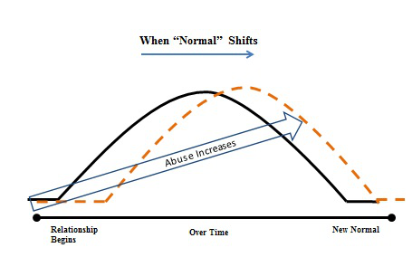

https://youtu.be/Svo-SjRDPKQ

# Chapter 4: Coping Mechanisms

### Introduction

Coping mechanisms could also be described as survival behaviors. They are used to counter our partner’s behavior, and often are reaction methods we established years ago in our childhood. Identifying these behaviors will begin your healing process.

### Purpose

The purpose of Chapter 4 is to help you identify you coping mechanisms. Self responsibility of your perpetual patterns and reactive behaviors is very important so you can create the steps for conscious change. Accepting God’s love and knowing you are worthy is a foundation part of this change taking root.

### Shift from normal

When you have been pulled out of normal, it is difficult to know what normal is. Often these relationships start off electric, intense, passionate and we are swept off our feet. Over time the abuse begins to show a little at a time. We make excuses and justify the abuse. This is the beginning to a shift to what becomes a new normal for acceptable behavior in relationships.

### Gratefulness

You will be forever grateful that you have been jolted awake, because now God can complete a work in you. There is a way out of the well you have fallen into.

### Response

When this shift occurs, we begin to deny, justify, make excuses and shift blame. Often in abusive relationships, we learn to run from, stuff down or hide our emotions. You learn that these are safer responses to confronting those that hurt us. We learn quickly that confrontation leads to danger. We develop techniques to survive including detachment and we learn how to become emotionally numb.

### Share and connect

Have you ever told anyone about your unhealthy behaviors?

If you answered, “Yes,” who did you tell? What happened when you did?

If “No,” why have you kept it hidden?

### Confess to one another 

True healing can occur when we confess to one another and receive the full blessing of Jesus.

> *“Therefore, confess your sins to each other and pray for each other so that you may be healed. The prayer of a righteous man is powerful and effective.”*  
**— James 5:16 (NIV)**

### Secrets 

You are as vulnerable as your deepest secret. By confessing areas where you are unhealthy, you are released to receive God’s mercy.

> *“[She] who conceals [her] sins does not prosper, but [she who] confesses and renounces them finds mercy.”*  
**— Proverbs 28:13 (NIV)**

What secrets would you like to get rid of today?

### Ask God to help 

God reveals vulnerable areas, bad habits or behaviors that need to change.

> *“…Wash me, and I will be whiter than snow.” — Psalms 51: (NIV) “Direct my footsteps according to your word; let no sin rule over me.”*  
**— Psalms 119:133 (NIV)**

What is God revealing to you that need to change?

### Unlock the potential

Women need to understand the depth of God’s love for them. Many of you still feel worthless, invisible, not good enough and you struggle with accepting they are worthy. When a woman finally starts believing she is worthy of God’s love she has the a key to unlock her full Stronger than Espresso potential!

### God’s Promise 

He who began a good work in you should complete that work until the finish.

> *“Be confident in this, that He who began a good work in you will carry it on to completion until the day of Christ Jesus.”*”*  
**— Philippians 1:6 (NIV)**

### Spiritual awakening 

One day, after finishing a three-day Christian women’s conference, I went to the ocean to swim. During that swim I was surrounded by angels and they were laughing and playing in the water with me. The water turned a fluorescent turquoise. I was surrounded by other people in the water but I saw no one else during this surreal experience. As each wave passed over me, I heard God’s voice whispering in my ear, “I love you, and I forgive you. Let it go.” I played in the water, laughed and cried washing away years of shame. I felt cleansed surrounded by the love of God and the angels.

When the imagery subsided, I made my way to the shore and lay down on the hot warm sand. With my eyes closed, I was unable to speak and tingled from head to toe. The experience that day filled the hole in my heart. I had personal cravings that could never be satisfied, but they were finally satiated at that moment. Filling that craving was a spiritual experience that transformed me from the inside out.

Since that day, I have made it my priority to surround myself with good people and make healthy choices that protect the beautiful spirit I have. This allows me to walk by faith and trust that God will protect me and shine the lamp on the road I must travel. It was not overnight but my journey began that day. Years now have past, and a strong faith in God has blessed my life. I am healing the pain of the passed and building new pathways from old broken patterns of behavior. Freedom in Him!

### God’s grace and love 

God’s love for you has no limits.

> *“But because of his great love for us, God who is rich in mercy, made us alive with Christ even when we were dead in transgressions – it is by grace you have been saved. And God raised us up with Christ and seated us with him in the heavenly realms in Christ Jesus, in order that in the coming ages he might show the incomparable riches of his grace, expressed in his kindness to us in Christ Jesus.”*”*  
**— Ephesians 2:4–7 (NIV)**

### How to accept God’s love 

After so many years of not feeling worthy of love, it can be difficult to accept God’s love. A simple prayer can release God’s blessing and favor over your life. Just say this prayer aloud.

> *“That if you confess with your mouth, ‘Jesus is Lord,’ and believe in your heart that God raised him from the dead, you will be saved.”*  
**— Romans 10:9 (NIV)**

### Priestly blessing 

Bringing God into your life can release blessings over all areas in your life. This is a wonderful blessing to say daily or when you need relief from a difficult and stressful situation.

> *“The Lord bless you and keep you; May the Lord make his face shine upon you and be gracious to you; the Lord turn his face toward you and give you peace.”*  
**— Numbers 6:24–26 (NIV)**

### You have strength in God 

It can be scary to break away from old behaviors. New emotions of joy and feelings of strength do not feel comfortable. Low self-esteem and past hurts have held you back from growing. Know that you have a strong God and cannot be bullied. With Him in your life you have the strength to conquer any challenge that is presented in your life.

> *“The Lord is my rock, my fortress and my deliverer; my God is my rock, in whom I take refuge. He is my shield and the horn of my salvation, my stronghold. I call to the Lord, who is worthy of praise, and I am saved from my enemies.”*”*  
**— Psalms 18:2–3 (NIV)**

### God your protector 

No longer will you face a hurt alone. As a child of God you are protected by his covering. This does not mean bad things won’t happen to us; it does mean that when they do we can ask for His protection to carry us through the challenge.

> *“How is your view of your Heavenly Father different than your earthy father?”*

> *“Keep me as the apple of your eye; hide me in the shadow of your wings from the wicked who assail me, from my mortal enemies who surround me.”*  
**— Psalms 17:8–9 (NIV)**
