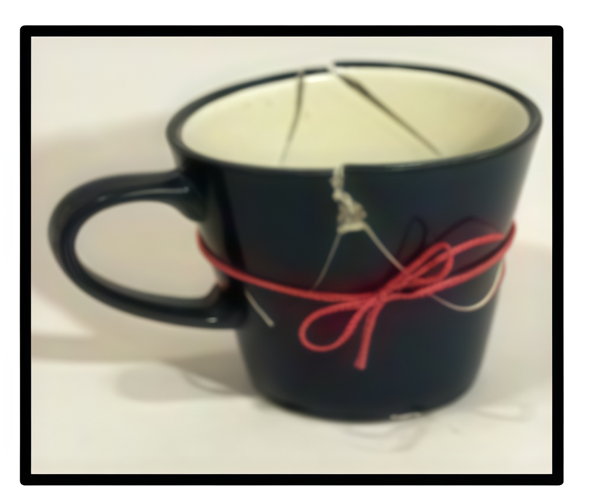

# Chapter 5: Reoccurring Themes

### Purpose

The purpose of Chapter 5 is to help you identify the reoccurring themes in your life. The reoccurring themes begin as your destructive self-talk. They penetrate your self-esteem, your relationships, your ability to set healthy boundaries, and often restrict your view of your own value. Only by identifying these themes can your alternative self-talk begin to change.

### Introduction

In the last chapter we learned about our feelings. This chapter helps you discover your reoccurring themes, what fears you have, and what stumbling blocks exist and any challenges you must confront. Be honest in your self-assessments. When you see your situation for what it is, you can transform. Overcoming denial is the first step to your new life.

### The “Usual to go”

You pull open the glass door of your corner coffee shop filling your lungs with air permeated with a thick and pungent aroma of freshly ground dark-roast coffee. The store bustles with early morning activity as you take your place sandwiched in line between busy professionals chattering on cell phones, soccer moms on a mission and a few “grunters” that will not speak or make eye contact until they get that first cup of java. As you wait, your foot taps to the beat of a jazz melody playing through the café sound system. When you hear the coveted sound, “Next,” you make eye contact with the barista and stride toward the counter.

You order,

> _“Good morning, I will have the usual.”_

The barista smiles, creates your customized coffee creation and says, “One usual to go.” You grab your “usual” and go about your day.

A “Barista" is one who has acquired some level of expertise in the preparation of espresso-based coffee drinks. They take your order and create a coffee delight with coffee beans, various methods of steamed milk and other add-ins to the drink.

They can make endless varieties of drinks, yet they

> _“serve what you order.”_

### Try something new

Life is a continued repetition of learned patterns of behavior. If you continue to ask for the same thing every day, then you will continue to receive the same outcome. Only when you begin to branch out and try something new can a different outcome occur.

### 3-Legged stool 

> _“For years I sat on a three-legged stool. Partners would kick out one of the legs just when I began to succeed. I continued to fall in love with men that were emotionally, verbally, physically and financially abusive. Why?”_

### What are my patterns?

The first step to any recovery process is to identify where you are right now. Understanding that your brutal reality is your beginning point. No matter how difficult it is to admit.

You must identify your patterns of behavior. This awareness allows you to correct and never say, “Oh, here, I go” again. A skill you must develop is how to identify those reoccurring patterns again in your life, and how to make different choices. Inviting God into your daily life and accepting His divine love will make this process easier. Rest assured that you have been “wonderfully made” by your God and with that mindset you can begin.

### Timing 

For everything God has a time and your time is now!

> _“There is a time for everything, and a season for every activity under heaven: a time to be born and a time to die, a time to plant and a time to uproot, a time to kill and a time to heal, a time to tear down and time to build, a time to weep and a time to laugh, a time to mourn and a time to dance, a time to scatter stones and a time to gather them, a time to embrace and a time to refrain, a time to search and a time to give up, a time to keep and a time to throw away, a time to tear and a time to mend, a time to be silent and a time to speak, a time to love and a time to hate, a time for war and a time for peace.”_  
> **— Ecclesiastes 3:1–8 (NIV)**

Remember, every day YOU have a choice of how you will feel and how you will spend your time or energy.

### Purpose 

> _“Ask and it will be given to you, seek and you will find; knock and the door will be opened to you. For everyone who asks receives; [she] who seeks finds, and to [her] who knocks, the door will be opened.”_  
> **— Matthew 7:7–8 (New King James Version)**

Have you ever been told God has a purpose for your life? If yes, good for you, but honestly, most of us don’t have a clue what our purpose is.

One way to find your purpose is to think of moments, memories, activities or specific settings when you are the happiest. The good news is these activities often represent God’s purpose in your life through your unique gifts.

Describe activities or settings when you are filled with joy and peace.

If you are saying, “I can’t do that” remember just ask and you shall receive.

### Change

Who is responsible:\
• You are the only one who can change your behavior.\
• You are not responsible for the behavior and actions of your partner(s).\
• You are free to choose any emotion or attitude regardless of your situation.\
• Reading God’s word daily will help you learn how to make better choices based on His lessons and guidelines.\
• Daily prayer time will train you to listen to His blessings over your life.\
• Transformation is not a quick fix; it takes time and dedication.

### Words to avoid

Saying words like, “never,” “always,” “no one” can be damaging to you. These words are not constructive to healthy conversation or healthy conflict resolution. Our words matter. They have power and authority. The Build, Break or Bond.

These statements can:\
• Blame others\
• Block forgiveness\
• Lack hope\
• Restrict God’s grace from fully working in your life\
• Keep you from changing your life

### Power of your tongue 

Be mindful of the words you say. Your tongue is a powerful tool. It can speak praise or it can speak negativity over your life.

> _“He who guards his mouth and his tongue keeps himself from calamity.”_  
> **— Proverbs 21:23 (New International Version)**

Later in this book, in the Seven Measures of Perfection, Ingredient #5 Power of Your Words, we dig deeper into understanding the role of the tongue in your life.

### Fake appearances 

> _“I had a college degree, professional career, came from a middle class background. From the outside it looked like I had the world on a platter. Yet, I chose to surround myself with destructive partners.”_

### Courage

It may be uncomfortable to speak those words right now. Courage is taking the first step. Over time you can practice a little at a time. The courage you have shown is to make a conscious solution to change your automatic response to hurtful behavior; a great first step.

You may be working with your partners at Stronger than Espresso® to connect and heal. You may be working with a counselor, sponsor, or trusted friend. It is important you seek someone to discuss these themes. Pray for God to help reveal ways to change and correct behaviors.

### “You can stand up in a little cup!”

You are courageous!

Even though you may be as small and delicate as a dainty teacup or demitasse, you are still strong and can stand up in your little cup!

### Relationship patterns

Identifying the patterns you have about love and relationships will help you understand how to evaluate your feelings in more depth. Later in the book we learn more about characteristics of abusive relationships.

Have you ever gotten into a relationship and then somewhere past the endless hours of pillow-talk, the candlelit dinners, the walks in the park, the kissing and other good stuff, that you find yourself saying, “Oh no, here I go again.” You realize that you are in another relationship that is just like the last one and now you don’t know what to do.

That’s great if I am falling in love, but what if I am still married or living with this person?

If you are in a current relationship with someone who is abusing you, then you need to seek help. Abusive relationships do not improve without intervention, counseling and the abuser changing. That can occur, but requires a long period of time. As long as you are in the home and in the abusive relationship – you are in danger of the abuse escalating.

Abuse is not okay. It is against the law.

### Self-check

Ask yourself, why are you drawn to these characteristics? Healthy relationships foster mutual respect, love and nurturing. In the next Chapter we learn about how our behaviors can impact our ability to set boundaries.

### Teasing isn’t for everyone 

> _“One day my husband started teasing me in a way that really hurt my feelings. He began to do this behavior when we were in front of other people. He would pat my head and say, “good girl” especially in front of other women he was trying to impress. I felt like a fool. Like a dog he was patting me on the head. It was demeaning and he would just laugh at me. Even when I asked him to stop, he just said, “I’m only teasing” and continued to do it. I got angry because I already told him and he wasn’t listening. When I tried to describe my hurt, humiliation, anger, or frustration, he did not validate my feelings nor take them seriously. He thought it was funny and tried even harder to get others to laugh when he did it to me.”_
