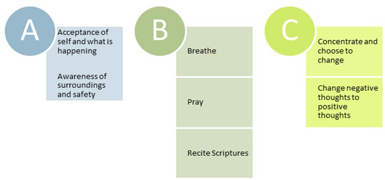

# Chapter 8: Communication Hooks, Medical Impact

### Purpose

Chapter 8 has two very important concepts.

First, understanding your behaviors, thoughts and feelings all influence one another is important to making lasting change. Developing coping strategies and ways to respond will help you build resilience.

Have you ever felt like you are having the same argument with the same people – but nothing ever changes? Have you ever felt like certain people are able to set you off, get you upset, make you feel inadequate just by having a conversation?

When you are able to identify how you are “hooked” in conversations by what is said to you or how you are treated will identify patterns on how you automatically react and respond. Knowing these patterns exist, you can begin to change your reactions and responses and gain more control in your life.

Therapy theories have evolved to improve best practices. One historical therapy theory states that all persons have three dimensions or ego states, the Parent, Adult, Child (PAC). In this Chapter there is a discussion of three ego states: adult, parent and child. This refers to the way we think and respond to the statements of others, not literally if we are a parent, adult or child.

Secondly, you need to be self-aware that you may have medical impacts and residual emotions from the difficulties you have endured in your life. Accepting and embracing the fact you are a woman. God created you with a woman’s body and you have woman’s issues, accepting those with self-love rather than self-hatred is important to healing inside and outside.

### Ego states Parent, Adult, Child

Have you ever felt like you are having the same argument with the same people – but nothing ever changes? Have you ever felt like certain people are able to set you off, get you upset, make you feel inadequate just by having a conversation?

Therapy theories have evolved to improve best practices. One historical therapy theory states that all persons have three dimensions or ego states, the Parent, Adult, Child (PAC). This theory is a part of Transactional Analysis, the study of social intercourse, personality, relationships and social intercourse. Transactional Analysis (TA) was developed by Eric Berne when his book, Games People Play, was published. His work is a foundation to many therapy methods designed including the use of TA. 5

It suggests each ego state performs specific functions. We move seamlessly between each of the ego states based on our current situation and the interactions occurring with others at that time.

A healthy person has a happy mixture of Parent, Child and Adult with the Adult driving the behavior.

Parent

Behavior

ADULT

Child

### Oughts & Shoulds

Many of us heard “because that’s the way it’s done” or “because I said so” growing up. Statement full of demands, oughts and shoulds we must follow are woven through the fabric of our lives. “Good girls do, nice girls don’t, you should do this, you should change this, You shouldn’t have done…” Too often these statement include requirements with them that make us feel manipulated, used and powerless. “If you want me to love you, then you must do…I only pick girls that make me feel like…” Often these statements contain the attitudes, feelings and behavior patterns from our parents or authority figures growing up. 7

When we hear similar statements from others it would be normal to react. The challenge is often our reactions are automatic responses and we may not even realize what impact it has on our thoughts, feelings and behaviors.

Our behavior can be adaptive where we modify behavior to be compliant. Feelings, emotions and our self-awareness can be automatically reactive as well when we hear these types of statements.

On the other hand, these statements can make us reactive, intentionally disobedient, or feel rebellious to the idea of being boxed in, told what to do, put in a corner, or trapped.

It is important for us to begin to identify our automatic reactions to these types of statements. Even if it is one comment at a time, you will begin to gain incremental steps of control into your life, just by how you respond.

### State of mind

In this theory, our adult state of mind is essential for coping and provides specific functions:

1. The adult state is logical and performs objective data processing.

2. The adult state can mediates between our own Parent and Child. 8

3. The Adult is free to take information from the Parent and the Child and act in a constructive way.

4. The Adult that is autonomous and can function intentionally letting the Parent guide and let the Child play, when appropriate. 9

### Games defined

Berne’s studies determined that "Games" are stereotyped, repetitive, mutually manipulative interactions between two people.

Games are defenses by which we seek to protect ourselves from not-okay feelings.

Every game has a pay-off for both people by perpetuating behaviors, feelings or fears that we believe to be true.

Games are the opposite of open, authentic, loving, and growing relationships. 10

### The beginning

Children observe their parents’ games and adopt an unconscious life plan or "script," which they will use through their life. They determine an expectation, which causes them to behave so as to make their script come true.

To the degree that a person's games and scripts are functioning outside their awareness, they are locked into feelings and behavior programmed by their old Parent and Child tapes. In this circumstance, any feelings of autonomy or freedom are an illusion and their growth potential is frozen until the tapes are reprogrammed. 11

### Can adults change?

The Adult does have the power to change by empowering the inner Adult to change from programmed responses to more spontaneous, appropriate, and constructive responses in each situation.

As people become aware of their games and scripts, and the destructive consequences; the motivation to change increases. 12 Changing these scripts requires commitment, dedication and perseverance, but it can be done.

### Equal states

As long as the interactions are complementary everything is smooth 13:

Parent Parent

Conversation

Gossiping

ADULT ADULT

Problem Solving

Child Child

Playing

Adult asks a question and receives a simple response from the other Adult. There is no emotion, no blame, no hidden agenda, just the answer to the question. When both individuals are in the parent or child states there is no problem.

### Different states

Problems occur when these lines cross over.

Conversation

Parent Parent

Gossiping

ADULT ADULT

Problem Solving

Playing

Child Child

| Question in Adult Ego State | Response in Various Ego States |
|-----------------------------|--------------------------------|
| “Where are my keys?” | If Adult answers, “On the desk.” If Parent answers, “You are always losing things.” If Child answers, “I hate it when you ask me to find your things. |
| “Why are you drinking so much?” | If Adult answers, “Yes I am. I hate my job right now.” If Parent answers, “Why are you always criticizing me?” If Child answers, “Don’t tell me what to do.” |
| “Is dinner ready?” | If Adult answers, “Not yet.” If Parent answers, “Why do I have to do everything?” If Child answers, “Quit blaming me.” |

### Back to adult state

You cannot return to the Adult state until the communication lines are cleared. This can take moments, days, months and years. In some cases couples are never able to return to the Adult state because of their games.

If you cannot remain in the Adult state, you will have the same discussion, fight, argument or interaction. This game will replay until you can adapt your behavior and response.

This communication folly perpetuates the games played between two people. To the extent that clear communication may be unable to exist outside this vicious cycle. 14

### You don’t see them at first

These events are not random and have been programmed into your behavior over years of experience and practice.

The Adult and Parent roles are often displayed in new social settings and external environments. The Child behavior is shielded by the Adult and Parent until the waters have been tested. 15 Then it comes out.

That is often why after you have gotten to know someone, you start to see the real them. It is often their “child” that comes out and you see them react and interact in certain settings.

### Break the cycle

So how do you break the cycle?

The games played go hand in hand with the coping behaviors learned earlier. They perpetuate the games. The most important thing that you can do is to be aware that you are being

> *“hooked.”*

Once you identify the source, the scripts can be redesigned and rewritten to bring a new outcome.

### Impact on relationships

The healthiest ego state is the Adult. Adults assume responsibility for their own behavior. Taking responsibility means that you do not blame others for your pain and suffering. You take control and do not release the ability for another to control your emotions.

Regardless of what ego state your partner demonstrates, you can choose which ego state you will respond with. Learn to ask God to help you respond. He will help you keep control. If they approach you as a child, you can respond from your adult state and stick to the facts. Problems can easily escalate when your Parent responds and reprimands their childish behavior.

Games are played in all relationships. When you are confronted with an argument, action or statement that “gets to you” how you react can make you play the game, or diffuse it. The next time that you are confronted with a situation that makes you uncomfortable, angry or sad, you have a choice on whether to let it “hook” you or not.

You will feel uncomfortable to do this at first. With God’s help you will learn that he is in control and you can establish new pathways.

### Impact with an abusive relationship

The challenge with an abusive relationship is that the same relationship rules do not always apply. Abusive cycles continue because the abuser blames others and there are complex emotional games that are played.

You believe that if you try hard enough, eventually they will be happy and stop hurting you. Once they are happy; you believe, you can finally achieve happiness too. If you continue to operate within the cycle of abuse and hope that the abuser will get better someday, you are fooling yourself.

Even if you remain in the Adult state it may not be enough to restore relationships with an abuser. Your good behavior will not change or improve this situation. You may have to distance yourself from the person or their behavior for complete healing. This could apply to a spouse, boyfriend, sister, brother, parent, coworker, or friend. Anyone who “hooks” you with inappropriate behavior and is abusive while you remain in the Adult state is not communicating in a healthy way.

You cannot change the abuser’s behavior; you can only change your own.

### Your response

Reflect on your answers in Chapter 4, Coping Mechanisms. The responses are a part of your hooks and perpetuate this game.

Start to recognize what your automatic responses are when someone “hooks” your emotional tender zones. It may take time to understand how you respond, but knowing how you react can help you begin to make changes.

You do not have to choose to play the same game. When you recognize game playing, stop and take a deep breath. Do not let it wound you to your inner core and hook the rebellious child. Instead try to put into perspective what is happening. Pray and ask God to give your guidance. You have the right to choose and decide what to do next.

It will take time, practice and prayer. You can do it. With God’s help — you absolutely can do it!

> *“With God all things are possible.”*  
**— Matthew 19:26**

### You can reestablish a new parent 

You carry an understanding of what a Parent should be based on the role models and your experiences growing up. As an adult you hold the hurts of your inner child and disappointments in the parenting you received. Let God’s grace heal you:

• God is your perfect parent. Pure love. Pure grace.\
• You can feel whole and receive all the wonderful qualities of the perfect parent.\
• You can love your own child and heal from the hurts of the past.\
• You can complete the void that is present.\
• You have the power to love yourself through these times without looking for external reassurances.\
• Your “hurts” of not being loved, fear of abandonment, or criticism received from your parents can be washed clean and no longer control your behavior.\
• You can be free from your past.

> *“Behold what manner of love the Father has bestowed on us, that we should be called children of God.”*  
**— 1 John 3:1 (NKJV)**

### Over time

Over time you will be faced with another difficult situation and your

> *“child” will run out in a rage and ready to have a temper tantrum. When this happens, pause for a moment and recall this visualization exercise. Let your Adult self come into the picture and hold the small child soothing their hurt. This validates your emotions and allows you to then face a problem without having an emotional “melt down.”*

> *“The discovery of the inner child is really the discovery of a portal to the soul. The inner child keeps us human. It never grows up, it only becomes more sensitive and trusting as we learn how to give it the time, care and parenting it so richly deserves.”*

### New parent, next step

God is your ultimate Father. Even though we know how amazing it is that he knows us, we often feel discouraged because our own parent relationships left us feeling broken. In the last activity you established a new parent in your life. As an adult now, you have the ability to comfort yourself even if the wounds of childhood still hurt. Next, we will look at the medical impact abusive relationships can have on our life. Self-love is important, even if you feel weak, broken, or not good enough. God made you in His image and God loves you — just as you are. Broken, never looked so beautiful!

### Why do I feel like this?

As any good coffee junkie knows…“Highs are high, lows are low, and without it, you crash.” Your daily cup of coffee brings highs and if you don’t get your daily dose, you can suffer some ill physical effects, such as: severe headache, confusion or irritability.

Our emotions are similar in that they vary from day-to-day and can be influenced by outside sources. However, you should be on the lookout for false highs and lows as they can be a sign of a serious medical condition.

In this lesson we will review common medical conditions that are the result of living in an abusive relationship. Just because they exist now does not mean they will remain for your lifetime. If you are experiencing these types of symptoms, it is not your fault.

Identifying them and getting the help you need is the key to your freedom.

### Medical conditions

These are common medical issues that can occur for women that have been impacted by domestic abuse:

• Depression\
• Addictive Behaviors\
• Premenstrual Syndrome (PMS)\
• Premenstrual Dysphonic Disorder (PMDD)\
• Stockholm Syndrome\
• Post-Traumatic Stress Disorder (PTSD)\
• Chronic Anxiety\
• Managing Trauma Symptoms

### Depression

Depression impacts millions of people each day.

Depression is often defined as, “Extreme melancholy, often with a reduction in vitality and physical systems.”16 To have the blues from time to time is normal. When you experience these symptoms consistently for several weeks can be the first sign of depression. Situational depression, left untreated, can turn into chronic depression and before more serious.

Typically, emotional turmoil begins to affect your moods, sleep patterns, and eating habits, which over a period of time can accumulate into a substantial problem. When you are upset you lose sleep and do not eat right. Lack of sleep and improper diet can aggravate and worsen your mood. A downward cycle is created and intensifies depression.

Fortunately, it can be cured with either therapy, medication or a combination of the two. Depression can be very difficult to spot in yourself so understanding the symptoms can keep you vigilant in protecting your well-being.

Depression is Anger Turned Inward. 17

You may not realize that you are angry, but through self-discovery you will locate the source of the emotions.

When you weed a garden, if you only pull the top leaves, the root remains. You have to dig deep to get to the cause. It can get your hands dirty to dig, but once you pull it out, the weed is gone!

Over time you stuff your anger down inside your innermost chambers pretending to be happy, and full of smiles for everyone to see. Yet this false front hides the fact you are emotionally hurting inside. You become immobilized to even cry out for help, and you hope that someone will notice your pain and sadness.

When you stuff feelings down, tension builds inside. At the foundation of your pain is ANGER. Anger is the emotion most closely aligned to your desire for self-preservation. What can be misleading is that anger can be, openly expressed, volatile and loud, or it can be silent and inward. Both forms of anger are equally as destructive. In any form, anger destroys the vessel it’s in.

### Are You Depressed?

Depression Inventory -Answer the questions with a Yes or No.

### Adapted from Source: NAMI.org. www.nami.org.

National Alliance on Mental Illness (NAMI).

> *“About Mental Illness: Major Depression,”*

### Scoring

If you answered

> *“Yes" to two or more of these questions, you may be experiencing some form of depression. Pay close attention to the following questions because “if you catch yourself in one or more of the behaviors, you can be assured that anger is alive within your personality.”*

For more information visit National Alliance on Mental Illness (NAMI).

### Get help 

Don’t be ashamed. Get the help you need.

Please get a professional evaluation by a medical doctor or seek therapy by a qualified counselor to relieve your suffering. If you need a referral, you can seek medical help and a doctor will refer you to a counselor. Counseling can really help. For more information about woman and depression check the National Association of Mental Illness, www.NAMI.org detailing depression.

You may also be eligible for free or low-cost counseling available for woman who have been abused. Contact the Stronger than Espresso® team to help, look for a Celebrate Recovery® program or resources through your church. Check your local phone book for hotline phone numbers for family centers or battered woman shelters, they can direct you to the resources that can help and are affordable.

Depression may not be the root cause; you may have signs of a different medical condition that can be identified with a simple exam or blood test.

If you ever feel in any danger of killing yourself or being killed, immediately call a local crisis line or visit www.suicidehotlines.com.18

> *“Women have to understand that regardless of who does not want us we have to want ourselves. Self-love is the first and hardest rule to stick by. Women need to not abandon themselves in their quest for bliss and love. You can love yourself spiritually, physically, in almost any way anybody else can.”*  
— Alice Walker, MS Magazine

### Addictions

Addictive substances and compulsive behaviors directly affect our mental, physical and emotional health. Alcohol and drugs, over eat, inappropriate sexual behaviors, excessive use of money, coffee, food, exercise, smoking, shopping can develop into dangerous habits and hazardous to your health.

It is a vicious cycle:\
• The more you use these behaviors as “Band-Aids” you avoid facing the issues that are the source of your pain.\
• You numb yourself to your pain so that you can cope.\
• The more pain you cover-up the more you need to mask your pain.

Recognize that every time you choose a dangerous behavior is one more time YOU choose and take responsibility for specific outcomes.

### Secondary gain

Have you ever heard of the concept of secondary gain? Secondary gain is an external motivator that keeps us from moving ahead in one direction because it has a greater hold on us than what we say we really want.

Here’s an example:

Participant

> *“I want to go to the gym but I am too tired after working each day.”*

Instructor: Why do you want to go to the gym?

Participant Answer: To be healthier, lose weight.

Instructor: When you get off work what keeps you from going?

Participant Answer:

> *“Tired, etc...”*

Instructor:

> *“Class what solutions do you see for her?” Class responds, “She could go at a different time of day.” “What do you think of that idea?”*

Participant Answer: “Well, I really don’t feel comfortable going?

Instructor:

> *“Tell me more about that.”*

Participant Answer:

> *“There are too many people.”*

Instructor:

> *“Why do too many people bother you?”*

Participant Answer:

> *“I am embarrassed about my body.”*

Instructor: “What do you feel when you are embarrassed?

Participant Answer: Fear, Unworthy, Ugly, etc…

In this example her FEAR of being embarrassed and not being good enough was greater than her DESIRE to be healthy and lose weight. Only by dissecting this thought process could we identify what was really driving the decision. This is the concept of secondary gain.

### Girl to Girl

Here are important points to consider:\
• If you can’t be sober with the man you are with and he can’t be sober with you, then send him packing.\
• If you have “self-destructive” behaviors, do not choose a partner who has the same habits. In time, you will succumb to those habits yourself and revert back to the person of your past, not the new self you are working to create and preserve.\
• Respect yourself. Respect the body, the heart, the lungs, the liver, the cells, the skin, and the sexual organs that your maker gave you. You are special, one of a kind, and deserve to have the longest, richest life possible.\
• Alcohol can worsen depression! If you think those drinks are “making you feel better,” you are incorrect.\
• When you are drinking, it is easy to begin to cloud your judgment and to feel there is no escape from your pain. Do not allow your thoughts to go down the suicidal path. Reach out to someone. Even though you may not believe it right now, there are so many alternatives to ease your pain. Don’t miss divine light shining on you.\
• If nothing else gets your attention, how about the fact that alcohol is full of calories! It can make your waist line thick and give you a tummy pooch. Quitting or severely cutting back can bring results within a few weeks -honest!\
• Do not replace one behavior with another one. If you quit drinking, don’t replace it with: compulsive eating, gambling, prescription drugs, illegal drugs or sex. Join a gym and let out your tension, take a dance classes or workout with a friend. Walk and walk and walk. Find healthy solutions to replace past behavior.\
• Phone a friend! Don’t be alone. That is when we are at our weakest time to make poor choices. Call and connect.

### I NEED my coffee

You wait in line for your coffee, tapping your toes incessantly, agitated because you have had a very bad morning. It started with a full blown fashion crisis because every pair of pants didn’t fit and your butt and thighs transformed into large cellulose stumps overnight. Grumbling under your breath, you know that everyone exists today just to upset you. “Non-fat latte with a double shot!” the barista yells. You step to the counter and a smiling face chirps, “Have a nice day.” Snarling you grab your coffee and think, “If you don’t wipe that smile off your face, I am going to make your day!” You leave the coffee shop feeling like a raging maniac. Your abdomen is cramping, it hurts to stand, your stomach is weak with nausea and you feel a migraine headache coming on. What are you experiencing? Yes, it is full blown PMS!

### It’s real not just in your head

Premenstrual Syndrome (PMS) and Premenstrual Dysphonic Disorder (PMDD) are very real conditions and must be embraced with love and understanding. If you remain at odds with your body and ignore your monthly cycles, it can be very damaging. Regardless of what jokes can be made, you need to understand that women, namely you, need self-love during this time. Some women may not be affected, others have mild symptoms, but many women become so affected that their daily lives are interrupted with their menses cycle. It is vital that you look at this monthly event as a part of your patterns of behavior. Like it or not, you must embrace your womanhood and understand times when you need to demand more self-love and love from others.

### Definition: PMS

Premenstrual syndrome (PMS) is a group of symptoms related to the menstrual cycle. PMS symptoms occur in the week or two weeks before your period (menstruation or monthly bleeding). The symptoms usually go away after your period starts. PMS may interfere with your normal activities at home, school, or work. Menopause, when monthly periods stop, brings an end to PMS.

### PMS Causes / Symptoms

The causes of PMS are not yet clear. Some women may be more sensitive than others to changing hormone levels during the menstrual cycle. Stress does not seem to cause PMS, but can make it worse. PMS can affect menstruating women of any age.

PMS often includes both physical and emotional symptoms. Diagnosis of PMS is usually based on your symptoms, when they occur, and how much they affect your life.

PMS often includes both physical and emotional symptoms. Common symptoms are:

• breast swelling and tenderness\
• fatigue and trouble sleeping\
• upset stomach, bloating, constipation or diarrhea\
• headache\
• appetite changes or food cravings\
• joint or muscle pain\
• tension, irritability, mood swings, or crying spells\
• anxiety or depression\
• trouble concentrating or remembering

Symptoms vary from one woman to another. If you think you have PMS, try keeping track of your symptoms for several menstrual cycles. You can use a calendar to note which symptoms you are having on which days of your cycle, and how bad the symptoms are. Keep a daily record of your cravings, food intake, irritability and physical symptoms. Then seek medical guidance from your local physician or an OB/GYN to discuss your symptoms and treatment options.

Estimates of the percentage of women affected by PMS vary widely. According to the American College of Obstetricians and Gynecologists, up to 40 percent of menstruating women report symptoms of PMS. Most of these women have symptoms that are fairly mild and do not need treatment. Some women (perhaps five to ten percent of menstruating women) have a more severe form of PMS. 19

### PMS Treatments

Many treatments have been tried for easing the symptoms of PMS. However, no treatment has been found that works for everyone. A combination of lifestyle changes and other treatment may be needed. 20 If your PMS is not debilitating, a healthier lifestyle may help you feel better and cope with symptoms.

• Neurotransmitters are produced in the brain from components of certain foods. A stable brain serotonin level is associated with a positive mood state. It appears that women have a greater sensitivity than men to changes in this brain chemical. Mood swings during the menstrual cycle and menopause are thought to be caused by hormonal changes that influence the production of serotonin. 21\
• How does diet play a role? The foods that increase the production of serotonin in the brain are high in carbohydrates. Many foods contain carbohydrates, such as candy, cereal, and pasta, can produce a temporary increase in brain serotonin—and a subsequent calming or anxiety-reducing effect. Carbohydrates affect brain serotonin because they increase the amount of tryptophan in the brain. Tryptophan is the amino-acid precursor of serotonin. Carbohydrate- rich foods influence serotonin level in the brain by boosting blood insulin. Insulin assists tryptophan transport across the blood brain barrier causing serotonin levels to rise. 22\
• Carbohydrate-rich meals (whole grain breads, crackers, rice, potato, pasta) often increase serotonin levels.\
• Vegetables, fruit and beans are carbohydrates, but feed into your system slowly. A good rule is to eat four cups of brightly colored veggies a day.\
• Candy, sweets and chocolate, are simple carbohydrates, which can increase serotonin levels, but the effect will only last 1 -2 hours.\
• pH Factor – Our bodies have a delicate pH balance. When our bodies run acidic it can cause a variety of health issues. Joint paint, anxiousness, sleeplessness and other disorders can be from the body being acidic. Coffee, soda, alcohol, refined sugars all strip the body of alkaline. Only fresh vegetables, fruits and whole grains can improve this condition.\
• Check if you are low in Vitamin D or B12 which can lower energy levels, memory loss, confusion and other symptoms. Simple blood tests can check these levels and easily can be added to your daily vitamin regime.\
• Protein, lean meats, dairy, and nuts can be eaten three times a day.\
• Be sure that you are getting enough vitamins and minerals. Take a multivitamin every day that includes 400 micrograms of folic acid. A calcium supplement with vitamin D can help keep bones strong and may help with PMS symptoms.\
• Adopt a healthier way of life. Exercise regularly, get enough sleep, choose healthy foods, don't smoke, and find ways to manage stress in your life.\
• Try avoiding excess salt, sugary foods, caffeine, and alcohol, especially when you are having PMS symptoms.\
• In more severe cases, drugs such as diuretics, ibuprofen, birth control pills, or antidepressants may be used.\
• Although PMS does not seem to be related to abnormal hormone levels, some women respond to hormonal treatment. For example, one approach has been to use drugs such as birth control pills to stop ovulation from occurring. Antidepressants that alter serotonin in the body have been shown to help many women with severe PMS.

### Premenstrual Dysphonic Disorder (PMDD)

Premenstrual Dysphonic Disorder (PMDD) is a severe, disabling form of PMS. In PMDD, the main symptoms are mood disorders such as depression, anxiety, tension, and persistent anger or irritability.

These severe symptoms lead to problems with relationships and carrying out normal activities. Women with PMDD usually also have physical symptoms, such as headache, joint and muscle pain, lack of energy, bloating and breast tenderness. According to the American Psychiatric Association, a woman must have at least five of the typical symptoms to be diagnosed with PMDD. The symptoms must occur during the two weeks before her period and go away when bleeding begins.

Research has shown that antidepressants can help many women with PMDD. 23

By taking the initiative and understanding your cycle, you can identify special times when you need more self-love. You may not have the patience, and you may be more moody and prone to tears. Your sadness, hopelessness and discomfort could be another pattern on top of the daily abuse you endure.

For more information contact the Office on Women's Health in the Department of Health and Human Services or the National Women's Health Information Center at www.4woman.gov.

### Stockholm Syndrome

It is common for people to criticize and say,

> *“Why doesn’t she just leave?”*

Often victims of domestic abuse have an emotional bond with the abuser and this is identified as Stockholm Syndrome. It can be found in family, romantic and interpersonal relationships, and is a strategy victims’ of abuse use for survival. Once you accept the impact that this bonding can have, you can begin to understand the behavior and why many stay.

The Stockholm Syndrome is named after an event on August 23, 1978 where two criminals carrying machine guns entered a bank in Stockholm, Sweden. They took four hostages, strapped them with dynamite and held them for 131 hours. After the rescue, despite the fact they feared for their lives, they supported the captors and began to feel the captors were protecting them from the police.

When certain conditions exist, the Syndrome can cripple the victim’s ability to operate autonomously and see the situation clearly.

1. The abused victim perceives a threat to their survival and believes that the abuser will carry this out.
2. The victim will often perceive some form of kindness from the abuser. The victim is often isolated from others, or given incorrect information about the situation.
3. Believe they are unable to escape the situation.
4. Victims will often support, love and defend their abusers even when it does not appear logical to others. 24

Understanding that you may be affected by this Syndrome, may allow you to work through breaking away. Recognize that your love and loyalty is not something you have done wrong or should be ashamed of. Discuss this with your therapist or counselor so they can assist you in recovery.

### Post-Traumatic Stress Disorder (PTSD) 

Everyday life contains stress and there are many ways you can choose to deal with it. Post-Traumatic Stress Disorder (PTSD) is a result of extreme stress and trauma and can be caused by a personal tragedy, accident, war, abuse or violent occurrence. PTSD is diagnosed when trauma escalates the normal reactions to stress into a

> *“super-stress.”*

Despite your best efforts of good stress management, you are still overwhelmed. When you feel threatened by this stress, the terror and horror can be so overwhelming that you lose memory and may even faint. Victims of sexual or physical abuse or an assault may have these symptoms. The world as you knew it has been changed. It no longer is safe, people cannot be trusted, your self-esteem is destroyed; faith and hope are lost. This reaction to stress can remain with you for days, weeks, years or a lifetime. 25

It is recommended that if you have experienced severe trauma you should seek medical help. If you are feeling overwhelmed, it is not because you are crazy or weak, but because you are affected by a medical condition.

Seeking group or individual therapy selecting a healthy lifestyle, and practicing relaxation techniques are all positive ways to begin. Unhealthy ways to deal with this stress include alcohol or drugs, running from the situation, or confronting the situation without the proper assistance.

Recognizing that you are having this problem is your first step. There are many resources available to assist you. For more information begin with your counselor or review information at the National Center for PTSD. www.ncptsd.va.gov.

> *“The Human Spirit is virtually indestructible and its ability to rise from the ashes remains as long as the body draws breath!” Author, Unknown”*

### Managing Trauma Symptoms

How do I fix these issues?

When traumatic events happen it may be months or years before you are able to get over what occurred. These events can leave long lasting symptoms of anxiety, depression, fear, flashbacks, nightmares, and phobias. Sometimes the symptoms of the trauma can also be diagnosed as a psychiatric or mental illness such as depression, bipolar, schizophrenia, and other disorders.

Your treatment plan will be based on the breadth of your impact and whether or not your symptoms originate from a medical condition or from your trauma. 27

To be restored ask God to shine His light on your next right step. Learning to trust his guidance will help you receive his blessings. Dedicate to working the Stronger than Espresso® program, connect with other woman and break the patterns of your past.

### Trauma scoring

If you checked "Yes" to more than two of these items, you are most likely dealing with trauma symptoms, or you may have a serious medical condition that needs attention.28

Seek the help of a physician and/or therapist to discuss how to manage these symptoms. Be comforted that in time they will pass and that you have the ability to heal 100%. The memories may never leave you, but the power and control they have over your emotional well-being will.

### Chronic anxiety

Living with chronic anxiety and tension is exhausting. Intensive attempts to people please, strive for perfectionism, and components of fear create cycling patterns of lack of control in our own lives and in our relationships. Despite your circumstances by identifying today your own behavior and making a few changes, you will be able to reduce chronic anxiety and tension.

### Don’t be anxious 

We have God’s word concerning anxiousness —don’t do it!

What a promise! The peace of God. How comforting, how easy would it be to lean into his chest and listen to his heartbeat?

> *“Be anxious for nothing, but in everything by prayer and supplication, with thanksgiving, let your request be made known to God; and the peace of God, which surpasses all understanding, will guard your hearts and minds through Christ Jesus.”*  
**— Philippians 4:6,7 (NKJV)**

### What to Do When Symptoms Happen? 

When the anxiety begins, your heart pounds, your hands clam up and you frantically look for the exits. Here are three medicine-free ways to try to calm and soothe yourself.

1. Pray. There are numerous scriptures that help us know to not be anxious and do not be afraid, just be still.

Studying certain scriptures is a good place to begin.

Review Psalms 46:10, Exodus 14:14, and Philippians 4:6-7.

2. Practice Principles of A B C 30

A. Acceptance of Self and what is happening.

Awareness of Surroundings and Safety.

B. Breathe.

C. Concentrate and Choose to Change.

Negative Thoughts to Positive Thoughts.

3. Phone a friend, coach, mentor, counselor, sponsor, accountability partner, neighbor, or coworker. Don’t be alone; reach out for help and support.

### Seek help

Review your answers to the questions on chronic anxiety or stress.

It is advised that during this time you seek the help of Christian women in the church, women Pastors, or Pastor’s wives.

You can move beyond the chronic phase, but it may require a treatment plan. Should you, at any time, feel that you cannot go on or are in danger of hurting yourself, contact someone immediately.

Your soul is a blessing to our earth and must be allowed to blossom, live and experience the life that it has been gifted.
