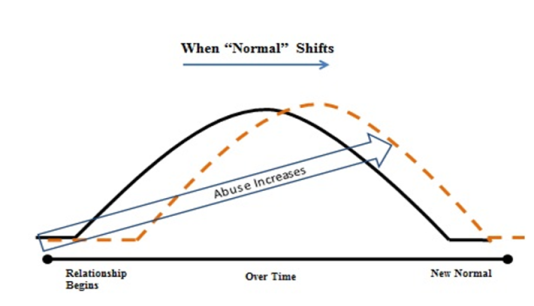

# Chapter 9: Powerless, Forgiveness, Bitterness

### Purpose

The purpose of Chapter 9 is for you to recognize that even though abuse in your life left a residual impact you are no longer powerless to your past. You CAN forgive and remove bitterness from your heart. By releasing these toxic emotions and burdens from the past you can become independent of your past and let God move more freely in your life.

### Change 

You cannot change the abuser, but you can change yourself. Arm yourself with knowledge so you can understand what you can change, and what you cannot. You do not have to repeat the past but in order to grow beyond it you must face the truth and learn from it.

> *“…His own special people, that you may proclaim the praises of Him who called you out of darkness into His marvelous light.”*  
**— 1 Peter 2:9 (NKJV)**

### The Fence: 

There was a little boy with a bad temper. His father gave him a bag of nails and told him to hammer a nail in the back fence every time he lost control of his temper. The first day the boy drove 37 nails into the fence. Then it gradually dwindled down. He discovered that it was easier to hold his temper than to drive those nails into the fence. Finally the day came when the boy didn’t lose his temper at all.

His father suggested that the boy now pull out one nail for each day that he was able to hold his temper. The days passed and the young boy was finally able to tell his father that all the nails were gone.

The father led his son to the fence.

> *“You have done well, but look at the holes in the fence,” he said, “When you say things in anger, they leave a scar just like these nail holes. You can put a knife in a person and draw it out. It won’t matter how many times you say, I am sorry. The wound is still there. A verbal wound is as bad as a physical one.” 31”*  
— Author Unknown

### I was embarrassed 

> *“My pattern of abusive relationships was kept hidden because I was an educated, smart woman, too ashamed to let everyone know how awful it was. I was always gullible or captivated by their promises and “grass is greener story”— and every time I would fall in love with the wrong kind of man. After it occurred so many times, I was embarrassed to admit my mistake to myself, family or friends. I felt alone and unable to share my true feelings with anyone I could trust.”*

### Age 21-30

| Age 21-30 |
|-----------|
| Age 31-40 |
| Age 41-50 |
| Age 51-60 |
| Age 61-70 |
| Age 71+ |

### Common themes:

| Common themes: | Review your memories for common people, places, events, situations. Record those similarities here: • • • • • • • |
|----------------|-------------------------------------------------------------------------------------------------------------------|
| New ideas to overcome | Brainstorm ideas to release your past: • • • • • • • • • |

### God never waste a hurt 

Your experiences matter to God. He never wastes a hurt.

> *“Blessed be the God and Father of our Lord Jesus Christ, the Father of mercies and God of all comfort, who comforts us in all our tribulation, that [she] may be able to comfort those who are in any trouble, with the comfort with which [she is] comforted by God.”*  
**— 2 Corinthians 1:3–4 (NKJV)**

### The right question to ask

> *“Why Do You Stay?” A continuous question that so many of us have and we struggle as we watch women we love battle this problem. Stay for fear, stay for love, stay to avoid shame. Helping women see that their sense of normal has shifted can help them explain why they do what they do. The real question we should be asking is, “Why they abuse?”*

### No one understood 

Many people said to my face,

> *“Why do you stay with him if it’s so bad? Why don’t you just leave?” Behind my back I would hear people saying, “Well, if it’s really that bad, she should leave That doesn’t make sense. She’s asking for it if she just stays. We can’t really help her, if she won’t help herself.”*

### Why Do You Stay?

The answer to these questions can be understood if you study the long lasting emotional damage done to victims of domestic abuse. Earlier we learned the medical impacts abuse can have. The Stockholm Syndrome clearly demonstrates one example of how victims can shift in their normalcy. This Syndrome can be found in any relationship within a family, friendship, professional or romantic setting.

The abuser’s role is one of control or authority, such as a parent, spouse or partner, or boss. The victims’ strategy to survive the abuse is to emotionally bond with the abuser. The victim supports, loves and even defends their abuser because of the emotional bonding that occurs.

Emotional bonding occurs when all four conditions are to be true:

1. Perceived threat to one’s survival and they believe the threat is real.
2. Perceived small acts of kindness from the abuser.
3. Isolation from the perspectives of others or from information about the situation.
4. Perceived inability to escape the situation. 32

### Abuser traits

An abuser will not “show all their traits” at the beginning. Rather they will reel in the victim, test them and ensure that they will be able to be controlled. The abuser may or may not be consciously aware that they are “reeling” you in. Many times, they have emotional or mental problems, or are a product of family heritage that has taught them how to treat others, which gives them a justification in their mind that this behavior is acceptable. Over time the victim becomes accustomed to certain behaviors and expected responses.

### Normalcy Shifts

When you are subjected to abuse day after day your tolerance level increases and your basis of normalcy begins to shift. This shift alters your view of what is acceptable behavior and you become able to withstand further abuse.

Remember Figure 3. When “Normal” Shifts from Chapter 4?

The abuse increases gradually. You would likely head for the exit door if you were subject to a higher level of abuse immediately.

As normal shifts the following occurs:\
• You receive a small amount of praise from the abuser and gain hope that this situation will improve.\
• Your self-esteem is damaged. You begin to believe you are the cause of the trouble. Falsely thinking you can improve your treatment by acting “good.”\
• Often you are isolated from your friends, coworkers, neighbors, and family members so the true reality of your situation is not apparent to them. The isolation makes your world smaller and smaller, and often the only link to the outside world is your abuser.\
• Often the abuser’s demands and emotional ups and downs require enormous amounts of energy and time. Their behavior drains your energy level to exhaustion levels.\
• The volatile nature and fear of the abuser requires you to sleep with one eye open. Sleep deprivation starts to play tricks on you. You become sleep deprived because you live in fear. Over time this distorts the truth and leaves you less able to differentiate your current situation from a healthy reality.\
• Without the ability to set boundaries and stop the cycle, the chances you will run away continue to decrease. Even though your heart and body wisdom scream that this situation is not good for you, you are held emotionally captive.\
• You grow too numb to discern and decode your feelings.\
• You may not be physically confined, capture or kidnapped, but you are mentally conditioned to believe there is no ability to escape. In your mind leaving the situation is not an option.\
• Even if you do “get away” they create so much drama in your life you still can’t get free. They hound you to get back together, threaten to take you to court, play cat and mouse games using the children as bait, harass you with repeated contact or stalk you in your movements.

In what ways has your “normal” shifted?

Describe people or situations that make you feel this way?

What are ways you can keep this from happening again?

### Powerless

Many of us grew up powerless. Powerless perpetuates our victim mentality. When we are child, we reasoned like a child. As we mature we need to put those ways behind us and gain power over our decisions, our lives, and our future.

Has anyone ever done anything in your childhood that left you feeling powerless?

| When I was a child, I talked like a child, I thought like a child, I reasoned

> *“11 | |
|-----------------------------------------------------------------------------------|------|
| like a child. [Your sense of being Powerless] When I became a man, I put the | |
| ways of childhood behind me. [Victory over Victim Mentality] For now we 12 | |
| see only a reflection as in a mirror; then we shall see face to face. Now I know | |
| in part; then I shall know fully, even as I am fully known.” | ” |”*  
**— 1 Corinthians 13:11, 12 (NIV)**

### Biblical View on Violence

What does the Bible say regarding family violence:

> *“Give up your violence and oppression and do what is right.”*”*  
— Ezekiel 45:9 (NIV)

> *“Do not make friends with a hot tempered man, do not associate with one easily angered.”*  
**— Proverbs 22:24 (NIV)**

> *“A hot-tempered man must pay the penalty if you rescue him, you will have to do it again.”*  
**— Proverbs 19:19 (NIV)**

### Coffee

Be prepared to sip on the strong, bitter drink until you are pumped up with the energy you need. Come on girls, drink it up and jolt awake!

### Explore and let go, for good

If you do not fully explore your patterns of behavior, you will find yourself back into another abusive relationship.

Asking God to transform your life will not guarantee you are free from pain or hardship. It does guarantee you will never face situations alone again.

You have stuffed fears and feelings down for years. Some of you have stayed in a relationship for years and remained miserable. Others have had the courage to leave but found you repeated the same old patterns – again.

Once you understand these patterns, you can heal.

It is time to build a foundation of forgiveness. This allows you to grow beyond your past so it does not repeat.

### Forgiveness

You must forgive those who hurt you.

Have you ever heard the saying, “Anger destroys the vessel it is in.”?

If you do not forgive those who hurt you, you will be the one that hurts. Forgiveness does not mean that it erases what that person did to you. Forgiveness stops you from holding on to the past so God can fill you with the next opportunity.

### Bitter or Better?

Will you become bitter or better? The root of bitterness produces fruit of

anger and hatred. Bitterness will cost you future blessings and take things out of your life you cannot get back.

> *“See to it that no one falls short of the grace of God and that no bitter root grows up to cause trouble and defile many.”*  
**— Hebrews 12:15 (NIV)**

### God helps us forgive 

God has a clear message on forgiveness:

1. God made it clear we need to forgive:

> *“Our Father in heaven, Hallowed by Your name. Your kingdom come, Your will be done. On earth as it is in heaven. Give us this day our daily bread. And forgive us our debts, As we forgive our debtors. And do not lead us into temptation, But deliver us from the evil one, For Yours is the kingdom and the power and the glory forever. Amen.”*  
**— Matthew 6:9–13 (NKJV)**

2. We must forgive others:

> *“Therefore if you bring your gift to the altar, and there remember that your brother has something against you, leave your gift there before the altar, and go your way. First be reconciled to your brother, and then come and offer your gift.”*  
**— Matthew 5:23, 24 (NKJV)**

3. Forgive our enemies, for that is when you can truly be free:

> *“But I say to you, love your enemies, bless those who curse you, do good to those who hate you, and pray for those who spitefully use you and persecute you.”*  
**— Matthew 5:44 (NKJV)**

4. God tells us that he will give us the patience to forgive:

> *“A man’s wisdom gives him patience, it is to his glory to overlook an offense.”*  
**— Proverbs 19:11(NIV)**

• Who do you need to forgive and why?\
• What holds you back?\
• What is the first step you can take to forgive?

### Self-forgiveness

The last segment of Chapter 9 is to forgive yourself. Self-forgiveness can be one of the most difficult things to do and it comes in layers. We recognize that God has forgiven us, but we still struggle to forgive ourselves. We say we do, but then we pick it back up again and begin self-condemnation, worthlessness, self-doubt, fear, etc..

### The hardest forgiveness

Forgiving others is hard, but forgiving ourselves can feel impossible.

How do you forgive yourself?

> *“You don’t understand, I’ve made so many mistakes.”*

> *“I just can’t get over it.”*

> *“I don’t know why I did that.”*

> *“I am so ashamed.”*

### It takes time

Forgiving yourself takes time. It is not an overnight fix. Months, years can go by and you still feel the “twang” in your gut from the hurt.

Often the guilt can get worse as you get further away from the abusive lifestyle. You begin to see how you covered up, lied and made choices that made sense at the time; but no longer seem appropriate.

Forgiveness is often your regret. Sadness that you did….or did not ...

### God’s beat you to it 

God has already forgiven all your transgressions.

> *“As far as the east is from the west, So far has He removed our transgressions from us.”*  
**— Psalms 103:12 (NKJV)**

### Jesus and Peter

Jesus tells a story about true forgiveness and how much he loves us no matter what. We know Jesus forgives us, so it helps us ease up and realize that we too can forgive ourselves.

Peter was one of Jesus’ twelve disciples and the night of that last supper Jesus took great care with them washing their feet and being humble in their presence. Jesus tells Peter that before the night is over he will deny him three times. Peter says, “No way, God, that can’t be true. I love you.” Later that night Peter denies Jesus three times.

How would you have liked to deny the Savior?

Would you feel guilty and ashamed that you lied about him to others?

Peter was left with a pretty heavy burden to carry for the rest of his life.

Did Jesus hold a grudge? No.

He came to Peter in the ocean. He loved him. He invited him to come have breakfast together. Then he asked, “Do you love me?” Peter replied, “Yes,” Jesus gave him another chance and asked him to be a fisher of men and serve Him.

Jesus accepted Peter with open arms despite what he did in the past. Jesus gave Peter three chances to make right for each time Peter denied Him. Jesus is the God of second, third and ‘seven times seventy’ opportunities to redeem ourselves and reclaim our life through Him. Hallelujah!

Read this story in your Bible: John 13:6, 13:38, 18:25–27, 21:12, 21:15.

Have you ever felt like Peter?

### Release regrets

> *“He who covers his sins will not prosper, but whoever confesses and forsakes them will have mercy.”*  
**— Proverbs 28:13 (NKJV)**

> *“Therefore confess your sins to each other and pray for each other so that you may be healed. The prayer of a righteous person is powerful and effective.”*  
**— James 5:16 (NKJV)**

Releasing regrets is a part of your forgiveness process.

1. What do you regret?

2. List areas in your life where you feel shame or guilt?

3. Describe your life if you were able to let that regret go?

4. What steps can you take to make that possible?

### Stop, Drop and Roll

Three easy steps to self-forgiveness.

Stop. Drop and Roll.

1. Stop regrets.

2. Drop to your knees in prayer.

3. Roll to keep you from the fire of self-hatred that destroys all God wants you to be.

### Pray to fill the holes

When we fill the holes prayer will be a lifeline and can sooth those hurts. Sometimes we don’t know exactly how to pray or what to pray for. There is no wrong way to pray. Spending time with God is the key and will allow you to grow from there.

Here is a sample prayer you can use for a guideline if you like:

Lord I thank you Heavenly Father for this opportunity to serve you. I ask for your Holy Spirit to come now and cover me.

Anoint me and protect me Lord.

I ask you now Lord that you fill my holes now Lord.

Fill the hole of (specifically name the emotion or hurt: anger, fear, sexual abuse, pain, etc.) with your joy and amazing grace. Leave me noticeably changed from your presence.

Let me forgive those (or insert specific name(s)) that hurt me in my past.

I ask forgiveness for my sins and all resentment and anger to be released. Fill me with your love and grace Lord.

Now Father I forgive myself.

Protect us Father and in your name we pray. Amen.

Audience tip: When each woman finishes praying in your group you can add: Your word says when two or more are together we can ask a “thing” and it shall be.

### Write your own

Write your own forgiveness prayer. Forgive them. Forgive yourself.
